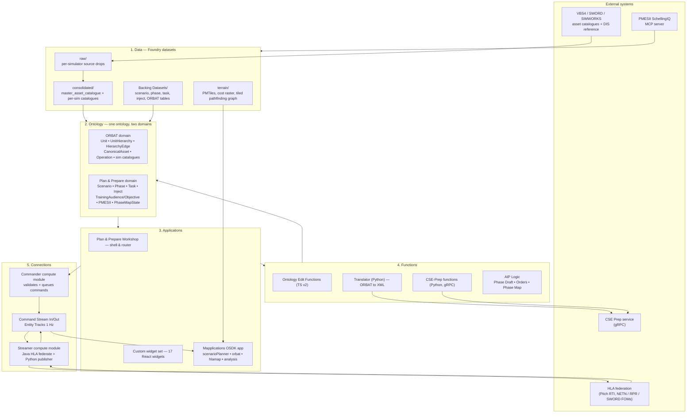
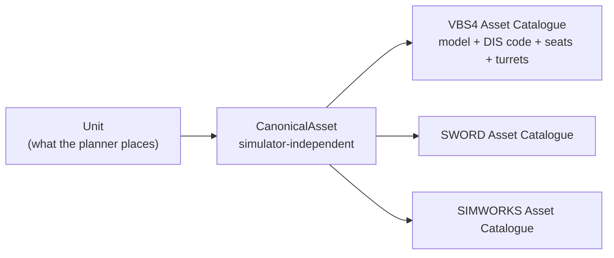
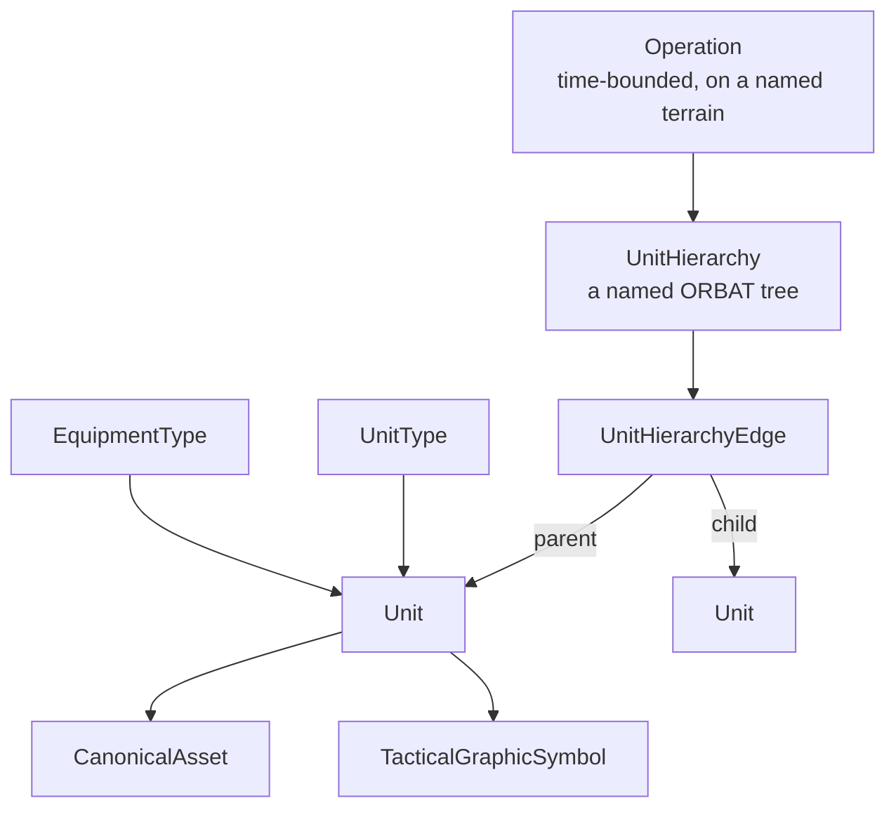
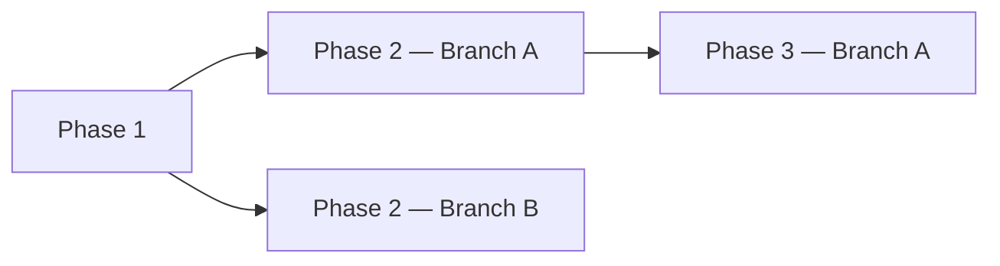
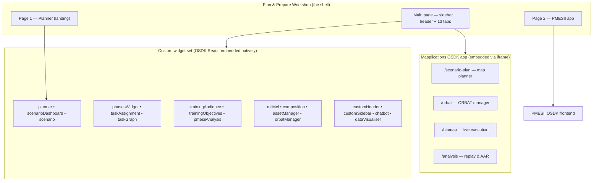
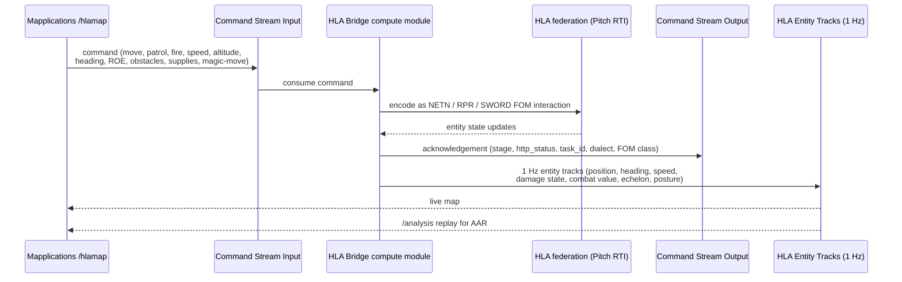
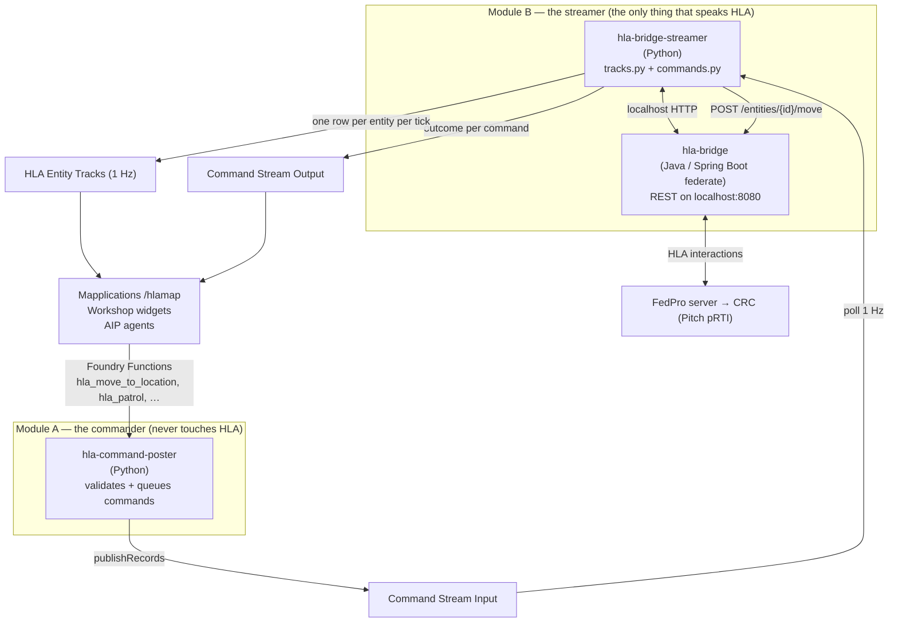
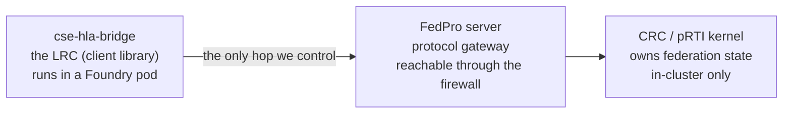

# NEXGEN Common Simulation Platform (CSP) — Platform Overview

> **Purpose of this document.** An end-to-end explanation of *what the CSP is*, *how the pieces
> fit together*, and *how data flows* from external simulators through Foundry and back out again.
> For a resource-by-resource breakdown (every dataset, object type, repo, function and app),
> see [`CSP_RESOURCE_REFERENCE.md`](./CSP_RESOURCE_REFERENCE.md).
>
> Scope: the `[NEXGEN] Common Simulation Platform` Foundry project, excluding the
> `0. Prototyping`, `Experimentation` and `PMESII (depr)` folders and other superseded assets.

---

## 1. What the platform is

The **Common Simulation Platform (CSP)** is a Foundry-based system for designing, preparing,
executing and analysing **military training exercises** — primarily Computer-Assisted Exercises
(CAX), but the model also supports CPX and FTX.

It exists to solve one problem: **exercise planning and simulation execution are normally locked
inside individual vendor tools.** An ORBAT built for VBS4 cannot be run in SWORD; a scenario
written in a document cannot drive a simulator; the results of a run cannot easily be replayed
against the plan.

CSP's answer is to make the **Foundry Ontology the single, simulator-agnostic source of truth**
for an exercise. Everything — the force structure, the scenario narrative, the phase-by-phase map
state, the terrain, the injects — is modelled once as ontology objects. Every downstream
capability (AI generation, map planning, XML export, live HLA execution, after-action replay)
reads from and writes back to that same model.

### The four operating stages

| Stage | What happens | Where it happens |
|---|---|---|
| **Plan** | Define the scenario, strategic context, phases, training audiences, objectives, PMESII-PT variables | Plan & Prepare Workshop + custom widgets |
| **Prepare** | Build the ORBAT, place units and tactical orders on terrain, write MEL/MIL injects, wargame each phase forward | Mapplications OSDK app + AIP Logic |
| **Execute** | Push the composition to a simulator (CSE / HLA federation or XML export) and drive it live | CSE-Prep functions, HLA bridge, command streams |
| **Analyse** | Replay the 1 Hz entity-track feed against the plan for AAR | Analysis screen |

### Two sub-projects

| Folder | Role |
|---|---|
| `CSP/` | The main platform — data, ontology, applications, functions, simulator connections, AI agents |
| `PMESII/` | A satellite capability modelling the political/operational environment (stakeholder bargaining, "SchellingIQ") |

---

## 2. Architecture at a glance



Five numbered folders under `CSP/` map exactly onto the layers above:
`1. Data` → `2. Ontology` → `3. Applications` / `4. functions` → `5. Connections`, with
`6. AI Agents` sitting alongside as conversational access.

---

## 3. The data layer — how raw simulator data becomes usable

### 3.1 Ingest

Vendor asset libraries and protocol references land in `1. Data/raw/`, one area per source:
VBS4 reference, SWORD (the 029 model), SIMWORKS, the DIS code reference, and CSE prep data.
These are the vendors' own model catalogues — each simulator names, classifies and codes its
entities differently.

### 3.2 Reconcile — the canonical asset bridge

This is the most important transformation in the platform.

Two Python transform repositories (`nxg-data-transforms` and `[NXG] Canon <-> Sim Matching`)
normalise every vendor catalogue and match its entries against a **canonical asset** — a
simulator-independent definition of an asset class (category, subcategory, military domain,
nationality, simulation class). The output is `master_asset_catalogue` (~1,600 canonical assets)
plus one cleaned catalogue per simulator, each row carrying a `canonicalAssetKey` foreign key.



**Why it matters:** because a Unit resolves to a CanonicalAsset rather than to a vendor model,
the *same* ORBAT can be exported to VBS4, SWORD or SIMWORKS. This is what makes the platform
"common". DIS codes act as the secondary matching key across systems.

### 3.3 Exercise data

`nxg-exercise-data` is a lightweight Python transform repo that emits the eleven tables backing
the Plan & Prepare and ORBAT object types (scenario, phase, task, inject, training audience,
training objective, PMESII domain, units, edges, hierarchy, operation). It seeds the platform
with three demonstration exercises — **IRON FORGE 26**, **NEXGEN 26** and **Operation BALTIC
SHIELD** — each with four phases on D+/H+ offsets.

Live state does *not* come from re-running this transform. It comes from **Ontology edits**
layered on top of these datasources, made through Actions from the applications.

### 3.4 Terrain

Terrain is prepared once and consumed heavily at runtime:

* **`northnordic2.pmtiles`** — the vector basemap, served **from a Foundry dataset, never a CDN**
  (important for classified/air-gapped deployment). Map glyphs and sprites are served the same way.
* **Terrain Cost Raster / Cost Raster (Graph)** — per-cell traversability cost.
* **`Tiled Pathfinding`** — the cost graph split into spatial tiles so the browser can lazily
  fetch only the tiles a route touches.
* A **chunked planet basemap** (~21,900 per-cell PMTiles archives) provides global coverage for
  the standalone globe view.

---

## 4. The ontology layer — the shared model

One ontology, two clearly separated domains, plus a small PMESII extension.

### 4.1 ORBAT domain — *what forces exist*



Design points worth understanding:

* **The hierarchy is edge-based, not parent-pointer-based.** Each `UnitHierarchyEdge` is its own
  object carrying a `relationshipType` (`ORGANIC`, `OPCON`, `TACON`, `ATTACHED`, `ASSIGNED`) and
  `validFrom` / `validTo` dates. This lets command relationships *change over exercise time* —
  a company can be OPCON to one battalion in Phase 1 and ATTACHED to another in Phase 3 — without
  destroying the underlying structure.
* **Units carry both real-world and simulator identity**: lat/lng, SIDC symbology code, echelon,
  affiliation, allegiance, military service — *and* `owningSimulator`, `simulatorIdentifierCode`
  and `dis6Code`.
* Several object types implement shared **interfaces** for temporal validity
  (`validFrom`/`validTo`) and unit symbology (`sidc`, `echelon`, `affiliation`, `allegiance`),
  so consumers can work polymorphically.

### 4.2 Plan & Prepare domain — *what the exercise is*

Strictly scenario-centric — everything hangs off `NxgScenario`:

```
NxgScenario                       (type CAX/CPX/FTX, classification, strategic context, progress %)
├── NxgPhase                      (sequence, startOffset/endOffset e.g. "D+0", basedOnPhaseId)
│   ├── NxgTask                   (assignedTo, approvedBy, section, dueOffset, aiAssisted)
│   ├── NxgInject                 (MEL/MIL: INTEL|CYBER|LOG|CIMIC, dayOffset, expectedResponse)
│   ├── NxgTrainingObjective
│   └── NxgPhaseMapState  (1:1)   (startStateMapJson / endStateMapJson)
├── NxgTrainingAudience
├── NxgPmesiiDomain               (PMESII-PT variable + aiGenerated flag)
└── NxgComposition                (federation protocol, RTI host, topology, Link 16, DIS legacy)
```

Two mechanisms deserve special attention:

**Relative time, not calendar time.** Phases, tasks and injects are all positioned with D-Day /
H-Hour *offsets* (`D+0`, `D+2`, `H+18`, `D-55`). A scenario can therefore be rescheduled or reused
without touching a single phase definition.

**Branching courses of action.** `NxgPhase.basedOnPhaseId` records the phase a phase was forked
from. Two phases sharing the same `basedOnPhaseId` are *alternative branches from the same
decision point*, which is what allows the planner to wargame competing COAs side by side.



**`NxgPhaseMapState` is the hinge of the whole planning loop.** It stores the entire map picture
for a phase as two JSON blobs: the start state (unit placements, objectives, orders) and the end
state (resolved positions, unit status, engagements, narrative). One phase's end state becomes
the next phase's start state.

### 4.3 Writing to the ontology

All mutations go through **Action types**, never direct dataset writes:

* **Simple CRUD actions** for scenario, phase, task, inject, PMESII domain, training audience /
  objective, phase map state, unit, hierarchy, hierarchy edge and tactical graphic symbol.
* **Function-backed actions** for anything transactional:
  * `[NXG-O] Generate Orbat` → `import_ontology_orbat_from_json` — bulk-import an entire ORBAT.
  * `[NXG-O] Reconcile Scenario Orbat` → `reconcile_scenario_orbat` — an **idempotent,
    transactional** upsert of a hierarchy plus its units and edges, which *can re-parent* units
    and deletes contradicting edges. Re-running converges. This is how the graphical ORBAT
    editors push a whole tree back in one call rather than emitting hundreds of small edits.

Every action carries an organisation-marking validation rule, so submission requires the correct
org membership.

---

## 5. The application layer — how the UI is put together

Three technologies are stitched together. Understanding the seams is the key to the front end.



### 5.1 Workshop as a shell, not a UI builder

Workshop supplies almost no visual widgets of its own here. It provides:

* **Routing** between three pages (landing planner → main workspace → PMESII).
* **State** — a `Selected Scenario` object-set variable, link-traversed to a
  `Selected Phase` object set, which is then passed as a parameter into most widgets. This is how
  independent React widgets stay in sync on "which scenario/phase am I looking at".
* **Layout** — a 200 px dark custom sidebar, a 55 px custom header, and a 13-tab section whose
  active tab is driven by a Workshop string variable that the *custom sidebar* writes to. The
  sidebar therefore drives Workshop's tabs rather than the other way round.
* **Embedding** — custom widgets natively, and the Mapplications OSDK app via bidirectional
  iframes pointed at specific routes.

The 13 tabs are: Dashboard, Scenario (Map + Overview), Phases, Task Management, Training Audience,
Composition, PMESII Variables, Exercise Area, MIL & MEL, ORBAT & Positions, Training Objectives,
AI Assistant, Execute, Analyse.

### 5.2 Custom widgets — the structured-data UI

The widget set is a single Vite/React repository with one entry point per widget. Widgets read the
ontology directly through the generated OSDK (`client(NxgPhase).where({ scenarioId }).asyncIter()`)
and **poll every 15 seconds**, which is how a change made in one tab shows up in another without
Workshop event plumbing.

Widget families:

* **Scenario management** — `planner` (landing page, scenario creation and AI scenario generation),
  `scenarioDashboard`, `scenario`, `phasesWidget`.
* **Exercise content** — `taskAssignment` and `taskGraph`, `trainingAudience`,
  `trainingObjectives`, `milMel` (MEL/MIL inject list), `pmesiiAnalysis`.
* **Force and asset management** — `orbatManager` (doctrine rules, NATO/APP-6 symbol builder,
  automatic child generation, CSE validation) and `assetManager` (per-simulator catalogue browsers,
  a DIS code explorer, SIDC decoding, and canonical↔simulator mismatch auditing).
* **Chrome** — `customHeader`, `customSidebar`, `chatbot`, `dataVisualiser`.

### 5.3 The Mapplications OSDK app — the heavy geospatial work

Anything involving a map, terrain or physics lives in a standalone OSDK React application,
embedded into Workshop via iframes and also reachable directly. It uses MapLibre with PMTiles
served from Foundry datasets.

| Route | Purpose |
|---|---|
| `/scenario-plan` | The phase map planner — place units, draw APP-6 tactical orders, preview routes and reachability, step through phases and branches |
| `/orbat` | Graphical ORBAT/hierarchy editor and composition builder |
| `/hlamap` | Live execution view over the HLA bridge — entity tracks and a command panel |
| `/analysis` | Playback of the recorded 1 Hz entity-track feed for after-action review |
| `/timeline` | Timeline view of the exercise |

Its important internals:

* **Terrain-aware routing** — a tiled router running in a web worker, reading the
  `Tiled Pathfinding` graph, plus reachability analysis that answers "can this unit actually
  reach that objective within the phase's time budget?"
* **Deterministic order resolution** — a movement and attrition engine that turns
  "units + orders + terrain + phase duration" into authoritative end-of-phase positions.
* **APP-6 symbology** — SIDC generation, echelon roll-up and symbol rendering, unit-tested.
* **Phase map state service** — loads/saves the `NxgPhaseMapState` JSON blobs and orchestrates
  the AI phase loop described next.

---

## 6. The AI layer — how phases are generated

The single most important design decision in the AI layer is the split of responsibilities:

> **The deterministic engine owns geometry and physics. The LLM owns intent and narrative.**

The LLM is explicitly instructed *not* to compute or adjust coordinates; resolved positions are
handed to it as facts.

```mermaid
sequenceDiagram
    participant U as Planner (user)
    participant APP as Mapplications planner
    participant L1 as nxgGeneratePhaseDraft
    participant L2 as nxgGenerateOrders
    participant ENG as Deterministic resolver<br/>(routing + attrition)
    participant L3 as nxgGeneratePhaseMap
    participant ONT as Ontology

    U->>APP: create / open a phase
    APP->>L1: seed + previous phase end state + audiences,<br/>PMESII, objectives, MEL/MIL, time scale
    L1-->>APP: narrative draft AND start-state map layout (single JSON)
    U->>APP: refine, or type free-text intent
    APP->>L2: intent + units + objectives + reachability context
    L2-->>APP: one order per unit (APP-6 task, destination, rationale)
    APP->>ENG: units + orders + terrain graph + phase duration
    ENG-->>APP: RESOLVED_POSITIONS (authoritative)
    APP->>L3: resolved positions + original orders + context
    L3-->>APP: per-unit status &amp; resolution, engagements, phase summary
    APP->>ONT: save start/end state to NxgPhaseMapState;<br/>create Phase/Task/Inject/Objective objects
    Note over APP,ONT: this end state becomes the next phase's start state
```

The three live AIP Logic functions:

| Function | Input | Output |
|---|---|---|
| **`nxgGeneratePhaseDraft`** | Phase seed, previous phase's end state (inherited units), existing audiences / PMESII / objectives / MEL-MIL, time scale, unit templates | A single JSON object containing **both** the narrative (title, intent, offsets, key objectives, audiences, PMESII factors, training objectives, injects) **and** the map layout (`selectedUnits`, `unitPlacements`, `objectives`, `movements` with APP-6 task names) |
| **`nxgGenerateOrders`** | Free-text commander's intent, current unit positions, objectives, terrain reachability context | One order per unit: APP-6 task name, destination, target objective, rationale |
| **`nxgGeneratePhaseMap`** | **Authoritative resolved positions**, original orders, objectives, phase/MEL-MIL/PMESII/objective context | Per-unit status (operational → destroyed, derived from attrition bands), per-unit narrative resolution, detected engagements, 2–3 paragraph phase summary |

All three run on Claude Opus in `non_strict` output mode and return raw JSON strings. The client
wraps them in a hardened layer: multi-strategy JSON extraction, control-character escaping,
truncated-JSON repair (for output-token cut-off), context-size guardrails and retry with
exponential backoff. Two supporting repositories (`Error Handling LLM-V2` and `LLM_structure`)
exist for this concern.

There is also a document-driven entry point — **Generate Exercise Scenario from Documents** —
which bootstraps a whole scenario from uploaded planning documents, and an
**Operations Chatbot** AIP Agent surfaced as the "AI Assistant" tab.

All AI-produced content is flagged in the ontology (`aiGenerated` on Scenario and PMESII Domain,
`aiAssisted` on Task), so provenance is always auditable.

---

## 7. The execution layer — getting the plan into a simulator

There are two complementary paths out of Foundry.

### 7.1 File/XML path — prepare a run

For simulators consumed as configuration:

1. The **Translator** Python functions read the ORBAT from the ontology (or from JSON) and
   generate simulator-specific XML — VBS4, SWORD or SIMWORKS.
2. The output is validated against the bundled XSD schemas (`vbs4.xsd`, `sword.xsd`,
   `simworks.xsd`, `validate.xsd`) via `validate_orbat_xml`.
3. The **CSE-Prep functions** (this repository) drive the CSE preparation service over gRPC:
   create a project, attach the ORBAT, validate it, publish, then run/stop a composition and poll
   its status.

The ORBAT manager UI validates against CSE *before* publish, so structural problems surface in the
planner rather than at run time.

### 7.2 Live path — HLA federation

For live execution, a closed command/telemetry loop runs through Foundry streams:



**Why streams rather than direct calls.** The command stream gives every order a `command_id` and
`correlation_id`, a TTL and a not-before time, and the output stream records the outcome of each
one. That makes the whole live session replayable and auditable, decouples the UI from federation
availability, and — critically — gives the only *durable* record of what was commanded. The bridge
itself keeps just the last 50 tasks in memory and loses them on restart.

#### 7.2.1 Two compute modules, three container images

The live path is not one service. It is deliberately split into two Foundry compute modules, and
the split is the single most important thing to understand about this layer.



| | **Module A — the commander** | **Module B — the streamer** |
|---|---|---|
| Purpose | Validate and queue commands; expose Foundry Functions | Speak HLA: publish entity tracks, execute queued commands |
| Containers | `hla-command-poster` only | `hla-bridge` (Java) + `hla-bridge-streamer` (Python) |
| Joins the federation? | **No** — never touches HLA | **Yes** — this is the federate |
| Foundry functions | ~24 registered (`hla_*`) | none — logs and streams are the only channel |
| Execution mode | Functions | **Pipeline** (minimum replicas ≥ 1) |

**Why they are separate.** Shipping a change to the track publisher redeploys the pod. When the
publisher sat next to the tasking federate, every publisher tweak tore down a live federation join —
and the RTI then held the unresigned federate name for the reconnect timeout (ten minutes here),
blocking the next start. Splitting them means the stream can be iterated on without disturbing the
federate that operators are tasking through.

The split costs two things worth knowing: it adds **a second federate** to the federation (a second
FedPro session and LRC port, and possibly a Pitch licence slot, since Pitch licences are commonly
capped by federate count), and **distinct `FEDERATE_NAME` values are mandatory** — two instances
joining under the same name are refused.

**Why the bridge is a Java sidecar rather than part of the Python container.** Entity state comes
from HLA, and Pitch ships Java and C++ bindings, not Python. The reader therefore has to be the Java
bridge, and the Python container reaches it over `localhost:8080`. Co-locating them in one pod also
guarantees the read path and the write path hit the *same* federate — task history is kept
per-process, so a command posted to a different pod would be tasking a different federate with its
own view of the federation.

**Why the track publisher is a background thread, not a Foundry schedule.** The bridge's REST API is
bound to localhost inside the pod, so nothing in Foundry can poll it; and Foundry schedules are
minute-granularity, so 1 Hz cannot be driven from the platform side at all. Data has to be *pushed*
out. `tracks.py` and `commands.py` run as separate daemon threads inside the same container, so a
slow bridge call on the command path never stalls situational-awareness publishing.

**Compute modules have no egress by default.** A module cannot reach the Foundry URL — including
other Foundry services — until a **source with a network policy for that URL** is attached to it.
Until then DNS resolution itself fails and every publish dies while fetching a token, which reads as
an authentication failure and is not one. The source must be in the same project, have compute-module
import enabled, have an API name, and carry a policy for the Foundry enrollment URL. Sources can only
be attached while the module is **stopped**, and network-policy changes need a full restart.

#### 7.2.2 The federate: connecting to the RTI

There are three logically distinct addresses in an HLA deployment, and conflating them is the classic
failure:



* **LRC** (Local RTI Component) — the `se.pitch.oss.fedpro:fedpro-client-hla-evolved` library
  embedded in the bridge. This is us.
* **FedPro server** — Pitch's Federate Protocol gateway; the only thing the bridge ever dials.
* **CRC** (Central RTI Component) — the actual RTI kernel, resolvable only inside the simulation
  cluster. The bridge never talks to it directly.

Two hard-won facts govern the connection:

1. **`crcAddress` in the HLA local-settings-designator string is not the CRC address.** In FedPro's
   HLA-Evolved compatibility mode it is explicitly reinterpreted as the *FedPro server* address, and
   it is the only key special-cased that way — anything else without a `FedPro.` prefix is forwarded
   to the RTI as a plain LRC setting. The settings string is therefore exactly
   `crcAddress=<fedproAddress>` and nothing else.
2. **FedPro settings have a documented precedence order**, and its built-in defaults are
   `connect.hostname=localhost`, `connect.port=15164`. An earlier iteration set nine
   plausible-looking JVM properties, none of which FedPro reads — so every fallback connect attempt
   went to `localhost:15164` and was refused. The bridge now sets the two real keys,
   `FedPro.connect.hostname` and `FedPro.connect.port`.

Addressing derives from a single `CSE_ENVIRONMENT` digit following a fixed port pattern on a shared
firewall host, so moving between CSE-Prep environments is a one-value change; explicit
`FEDPRO_ADDRESS` / `CRC_ADDRESS` always win. Because the CRC's advertised address is **not stable**
here (a network booster changes both host and port, and connecting to the wrong one fails
indistinguishably from the CRC being down), the bridge tries a **candidate list** of CRC addresses
and reports which one answered — turning an ambiguous failure into a log line.

The bridge also handles lifecycle properly, in two places that had previously failed silently:

* It implements `connectionLost`, clearing the connected flag, dropping stale entity state and
  re-running the retry loop on the run-loop thread. Without it, `/health` kept reporting "connected"
  after a session drop and the bridge never recovered.
* It implements **both overloads** of every FedPro callback. FedPro only passes `producingFederate`
  to `discoverObjectInstance` when the RTI's `conveyProducingFederate` switch is on, and that switch
  is **off by default** — so an implementation overriding only the four-argument form would discover
  no entities at all.

By default `BRIDGE_CREATE_FEDERATION=false`. If the federation execution is absent then the
simulators are not running, and standing in for them produces the worst available failure mode:
`connected: true`, nothing discovered, nothing received — reading exactly like a subscription bug.
With creation off, an absent federation is waited on indefinitely (that wait deliberately does *not*
consume the retry budget) and the bridge joins the moment the real federation appears.

#### 7.2.3 FOM dialects: the bridge does not get to choose

NETN restructured tasking between FOM v3.0 and v4.0, and the two schemes are mutually
unintelligible — different class trees, parameter names, datatypes *and units*:

| | v2-era (`NETN-ETR` 2.0) | v4 (`NETN-ETR` 3.0 + `NETN-SMC` 1.0) |
|---|---|---|
| Task class | `ETR_Root.ETR_Task.MoveToLocation` | `SMC_EntityControl.Task.MoveToLocation` |
| Who is tasked | `Taskee` (UUID) | `Entity` (UUID) |
| Who ordered it | `Tasker` — a callsign **string** | `Tasker` — a **UUID** |
| Headings | radians | **degrees** |
| Durations | int32 **seconds** | int64 **milliseconds** |
| Acknowledgement | `TaskStatusReport` | `ETR_TaskStatus` **and** `SMC_Response` |

Because the bridge may join a federation someone else created, the FOM that federation was created
with decides the dialect — and sending the wrong one is **not an error the RTI reports**: the class is
simply absent, or present with different parameters. So both dialects are implemented and one is
selected at connect time by probing which class names resolve. `BRIDGE_TASK_DIALECT=auto` is the
default; a forced dialect the FOM does not define **disables tasking** rather than emitting classes
nothing can receive. The live dialect is reported on `/status` and echoed on every tasking response,
so a response can be matched against an RTI trace without first working out which dialect was live.

The REST surface is deliberately **dialect-neutral** — the same paths, bodies and vocabulary
(degrees, seconds, lat/lon, readable enum names) whichever dialect is live — with the handful of
genuinely divergent fields logged rather than silently dropped.

The current target federation runs **`NETN-Merged-With-RPR.xml`** (NETN merged with RPR-FOM v2.0 in
HLA Evolved format). Two consequences follow from the model itself and cannot be fixed in code:

* `posture`, `mission` and `is_command_post` **do not exist in v4**, so those track-stream columns
  are permanently null. (`speed_mps` is empty for a different reason: the spatial decoder reads
  position and heading only.)
* **`UniqueId` is declared only in the NETN MIM**, and IEEE 1516-2010 accepts a MIM *only* on
  `createFederationExecution`. Since every NETN task addresses its target by UUID, if whoever creates
  the federation omits the NETN MIM then this bridge can monitor but will never be able to task — and
  nothing on our side can change that.

Loading the wrong FOM generation fails silently: classes resolve to nothing, subscriptions are
skipped at debug level, and entities arrive with a position, a callsign and almost nothing else. If
entities look half-filled, check the FOM generation before suspecting the publisher.

#### 7.2.4 The wire contract: why byte-level rigour is not over-engineering

The failure mode between two independent implementations of the same FOM struct **is not an error**.
Both sides are confident, one is misaligned or misreading units, and the only symptom is a simulated
entity that quietly does nothing. Three traps have actually bitten:

* **`LocationStruct` is geocentric ECEF metres, not latitude and longitude**, despite the name
  (NETN-BASE has separate `GeodeticPoint` / `GeodeticCircle` types for degrees). Converting to
  degrees puts the entity at the centre of the Earth. We misread this ourselves in early analysis.
* **`Speed = 0` means "sender expressed no preference"**, but a receiver honouring it literally holds
  the entity stationary — indistinguishable from the task being ignored.
* **`HLAvariableArray` pads after the element count** so the first element starts on its own octet
  boundary. A decoder reading elements straight after the count is 4 bytes out from the first element
  onwards, silently corrupting `Path` on patrol and the `Area` field of indirect fire, obstacles and
  comms disruption.

The mitigations are structural rather than hopeful:

* **Golden hex vectors** generated by a deliberately *independent* implementation, so agreement
  corroborates the encoding twice rather than just dumping our own encoder's output.
* Those vectors are asserted against the RTI's own encoder in a unit test that **runs inside the
  Docker build**, so a layout mistake fails the image rather than becoming a silently-ignored task.
* A **`bridge_preview_move_task`** endpoint that prints the exact field values, datatypes and bytes a
  real call would put on the wire *without sending it* — so an encoding disagreement can be settled
  with the owner of the receiving federate by exchanging an artefact rather than opinions.

One genuine ambiguity is documented rather than guessed: the standard's wording on whether an
**empty** variable array carries the padding that would precede a first element differs between
implementations (36 vs 40 bytes for `MoveToLocationTaskStruct`). This matters because a decoder that
omits the padding while the sender includes it reads `MoveType` from the padding (zero — a valid
enumerator) and `Speed` from `MoveType` (also zero), so the task decodes "successfully" with a speed
of zero and the entity holds still. Accepted, unmoved, nothing logged.

#### 7.2.5 The three distinctions the diagnostics exist to make

This layer is built around the fact that **success is not observable by default**:

1. **"Queued" is not "executed."** Replay safety rests primarily on **TTL**: a record older than its
   `ttl_seconds` is dropped, which is why a replayed disconnect cannot resign the federate every time
   the container restarts — control commands carry a short TTL for exactly that reason. A bounded
   in-memory LRU of seen command ids is a secondary defence only, since it is lost on restart.
2. **"Sent" is not "accepted."** HTTP 200 from a tasking endpoint means the interaction left the
   bridge, nothing more. The only evidence of acceptance is an acknowledgement (`ETR_TaskStatus` or
   `SMC_Response`; NETN-SMC requires a compliant federate to answer *every* entity control action,
   supported or not). `commands.py` therefore tracks `sent`, `acknowledged` and `unacknowledged`
   separately and logs them once a minute.
3. **A resolved handle is not a listening federate.** The FOM defining a class says only that we can
   send it. v4 entities may publish a `SupportedActions` attribute declaring what their simulator
   accepts, and NETN-SMC says to check it *before* sending; an entity publishing an empty list cannot
   be tasked whatever the FOM says.

`bridge_explain` collapses all of this into an ordered plain-text verdict (`HEALTHY` / `DEGRADED` /
`BROKEN`) suitable for a Workshop text widget or an AIP agent, and `bridge_get_federates` uses the
RTI's own MOM accounting to separate the three structurally different causes of "0 entities": wrong
federation (or one we created ourselves), a subscription gap on our side, or nothing publishing at
all. Diagnostics are bounded and purely observational — a 50-entry task ring buffer, one counter per
interaction class, one record per federate and per entity — so a wrong diagnosis cannot break tasking.

One trap worth internalising: the Foundry functions catch HTTP errors and **return them as a
payload**, so the function succeeds and the UI shows a green tick even on a 409. Callers must check
for `"ok": false` rather than trusting the tick.

---

## 8. PMESII — modelling the operational environment

The `PMESII/` sub-project models the political and social environment around the exercise, rather
than the exercise itself.

`PmesiiStakeholder` objects represent nations, organisations or individuals as actors on a policy
spectrum, each with a `position` (0–100), `salience` (how much they care), individual and group
`influence`, a `vetoPlayer` flag and textual `evidence`. This is a Schelling-style / expected-utility
bargaining model: given a set of weighted actors, it predicts where a coalition outcome will settle
and who can block it.

Stakeholders are discovered and maintained by AIP Agents talking to an external **SchellingIQ MCP
server**; the results surface both in the standalone PMESII frontend (Workshop page 2) and,
separately, as `NxgPmesiiDomain` narrative variables attached to a scenario in the Plan & Prepare
flow.

---

## 9. End-to-end walkthrough

Putting all of the above together, a full pass through the platform:

1. **Catalogue preparation (one-off / periodic).** Vendor asset libraries are ingested to `raw/`,
   reconciled by the matching transforms, and published as `master_asset_catalogue` plus per-simulator
   catalogues, all cross-linked by canonical asset. Terrain is tiled into PMTiles and a pathfinding graph.

2. **Create the exercise.** In the Planner landing page the user creates a scenario — manually, or by
   uploading planning documents and letting *Generate Exercise Scenario from Documents* draft the
   strategic context, phases and supporting content. A `NxgScenario` is created.

3. **Frame the exercise.** Training audiences, training objectives and PMESII-PT variables are
   captured against the scenario in their respective tabs.

4. **Build the force.** In the ORBAT manager the user assembles unit hierarchies — from templates,
   by automatic child generation from doctrine rules, or by AI structure generation. Units resolve to
   canonical assets and therefore to concrete VBS4/SWORD/SIMWORKS models. The tree is pushed back with
   `Reconcile Scenario Orbat`.

5. **Plan phase by phase.** For each phase the planner opens the map, inherits the previous phase's
   end state, drafts content with `nxgGeneratePhaseDraft`, expresses intent in free text, gets orders
   from `nxgGenerateOrders`, and has the deterministic engine resolve movement over real terrain.
   `nxgGeneratePhaseMap` narrates the outcome. The result is saved to `NxgPhaseMapState`. Alternative
   branches can be forked from any phase.

6. **Populate the exercise script.** Tasks are assigned and approved in Task Management; MEL/MIL
   injects are written against phases with categories, day offsets and expected responses.

7. **Prepare the run.** The composition (federation protocol, RTI host, topology) is defined; the
   ORBAT is exported to simulator XML and validated, or pushed to CSE Prep over gRPC and published.

8. **Execute.** Commands are issued from the live map onto the command stream; the HLA bridge
   translates them into FOM interactions against the federation and streams entity tracks back at 1 Hz.

9. **Analyse.** The recorded track stream is replayed in the analysis screen against the planned
   phases, orders and expected inject responses for after-action review.

---

## 10. Design principles to keep in mind when extending

* **The ontology is the contract.** Applications, AI and simulators all integrate through the
  ontology and its Actions, not with each other. New simulators should attach at the CanonicalAsset
  boundary and via a Translator/bridge, not by adding bespoke APIs.
* **Deterministic before generative.** Anything with a right answer (routing, reachability,
  attrition, XML schema conformance) is computed deterministically; the LLM is used for intent,
  drafting and narrative only.
* **Relative time everywhere.** D+/H+ offsets keep scenarios reusable.
* **Idempotent bulk writes.** Graph-shaped edits go through reconcile-style functions that converge
  on re-run, rather than long sequences of fragile individual edits.
* **No external runtime dependencies for maps.** Basemaps, glyphs and sprites are served from
  Foundry datasets so the platform can run disconnected.
* **AI provenance is recorded.** `aiGenerated` / `aiAssisted` flags travel with the data.
* **Assume success is not observable.** Across the simulator boundary, "queued", "sent" and
  "accepted" are three different facts and only the first two are visible without effort. Every
  integration should record which of the three it actually established — hence the command outcome
  stream, the acknowledgement counters and the diagnostics endpoints, rather than trusting a 200.
* **Encode against vectors, not prose.** Where two independent implementations must agree on a
  binary format, pin the agreement with golden vectors asserted in CI and provide a preview endpoint
  that dumps real bytes. A FOM struct disagreement does not raise an error on either side.
* **Isolate anything whose redeploy is disruptive.** The tasking federate and the track publisher are
  separate compute modules purely because redeploying one used to tear down the other's federation
  join, and the RTI then held the federate name for ten minutes.
