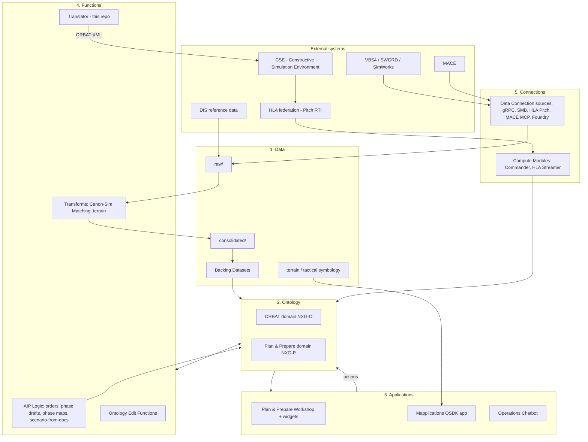
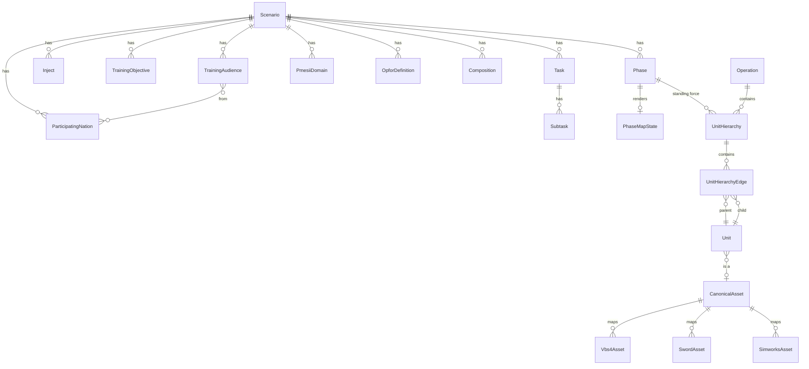
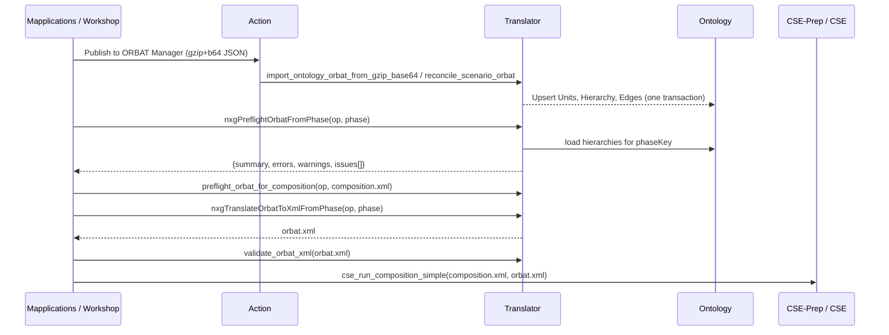

# Common Simulation Platform (CSP) — Project Overview

> **Audience:** engineers, demo leads and new joiners on the [NEXGEN] Common Simulation Platform.
> **Location of this file:** `[NXG] Translator` functions repository, `docs/CSP_PROJECT_OVERVIEW.md`.
> **Snapshot date:** 2026-11-01. Counts and resource lists below were taken from the live Foundry
> project on that date — treat them as indicative, not authoritative.

---

## Table of contents

1. [What CSP is](#1-what-csp-is)
2. [The exercise lifecycle CSP supports](#2-the-exercise-lifecycle-csp-supports)
3. [End-to-end architecture](#3-end-to-end-architecture)
4. [Project layout in Foundry](#4-project-layout-in-foundry)
5. [Data layer](#5-data-layer)
6. [Ontology layer](#6-ontology-layer)
7. [Functions & AI logic](#7-functions--ai-logic)
8. [The Translator (this repository)](#8-the-translator-this-repository)
9. [Applications](#9-applications)
10. [Connections, compute modules & simulator federation](#10-connections-compute-modules--simulator-federation)
11. [AI agents & MCP integrations](#11-ai-agents--mcp-integrations)
12. [PMESII sub-project](#12-pmesii-sub-project)
13. [How it all fits together — key flows](#13-how-it-all-fits-together--key-flows)
14. [Live data snapshot](#14-live-data-snapshot)
15. [Roadmap](#15-roadmap)
16. [Known issues & housekeeping](#16-known-issues--housekeeping)
17. [Glossary](#17-glossary)
18. [Resource index](#18-resource-index)

---

## 1. What CSP is

The **Common Simulation Platform (CSP)** is a Palantir Foundry–based platform for designing, planning,
resolving and launching **Computer-Assisted Exercises (CAX)** and related military training events.

Its core proposition:

* **One authoritative model of the exercise** — scenario, phases, objectives, injects, participating
  nations, OPFOR, and the Order of Battle (ORBAT) — held in the Foundry Ontology.
* **AI for the mechanical work, humans for the judgement** — LLM-backed functions draft scenarios from
  planning documents, write orders from a commander's intent, generate phase map states, run a lightweight
  war-game to resolve a phase end state, and build structured ORBATs. Every output is editable.
* **Simulator-agnostic force definition** — a unit is defined once against a *canonical asset* and then
  projected into whichever simulators are federated (VBS4, SWORD, SimWorks, and via CSE/HLA others),
  without re-entry.

The tagline used in demos: *"CSP doesn't replace your planners or your simulators — it connects them, and
keeps a human in the loop at every step."*

---

## 2. The exercise lifecycle CSP supports

| Stage | What happens | Main CSP components |
|---|---|---|
| **Design** | Create an exercise (CAX, wargame, plan, analysis). Upload planning documents (EXDIR, OPORD, scenario PDF) + prompt; AI drafts the world. | Plan & Prepare Workshop, `Generate Exercise Scenario from Documents` (AIP Logic) |
| **Prepare** | Review strategic context, PMESII, training audiences/objectives, MEL/MIL injects, tasks & approvers. | `[NXG-P]` object types + Create/Modify/Delete actions |
| **Plan a phase** | Add a phase (optionally *based on* a previous phase), type the commander's intent, generate orders, place units / graphics on the map. | Mapplications, `Generate Orders`, `Generate Phase Draft`, `Generate Phase Map`, Phase Map State |
| **Resolve** | "Generate End State" runs a lightweight AI war-game (LLM commanders per side) resolving movement, engagements and outcomes. | `[NXG] BGWS LLM Commanders`, `[NXG] Commander` compute module, `[BGWS] Events` dataset |
| **Compose ORBAT** | Publish map composition to the ORBAT Manager; AI builds a structured hierarchy per side, units matched to canonical assets. | `[NXG-O] Generate ORBAT`, `Reconcile Scenario ORBAT`, Translator import functions |
| **Validate** | Preflight checks: completeness, simulator coverage, composition fit, schema validity. | Translator `preflight_*` and `validate_orbat_xml` |
| **Simulate** | Export ORBAT XML per operation or per phase and submit with a composition to CSE; stream back via HLA. | Translator `translate_orbat_to_xml_*`, CSE-Prep functions, HLA Streamer |

---

## 3. End-to-end architecture



**Layering principle:** data lands in datasets, is reconciled across simulators in transforms, and backs the
Ontology. From then on *the Ontology is the system of record*: applications and AI write to it through
**Actions** (many backed by functions), and the Translator reads from it to produce simulator payloads.
Note that most operational data (e.g. units) now originates from user/AI edits rather than the backing
datasets — see [§14](#14-live-data-snapshot).

---

## 4. Project layout in Foundry

Project: `/Gotham Defence Demo Space-8e3f0e/[NEXGEN] Common Simulation Platform`
(namespace `ri.compass.main.folder.551c269a-b107-4b00-9484-3f59ab09e926`,
ontology *Gotham Defense Demo Space Ontology* `ri.ontology.main.ontology.cc5e8302-efb1-44a0-b5ed-94c47bef6b9e`).

```
[NEXGEN] Common Simulation Platform/
├── CSP/
│   ├── 0. Prototyping/        UI prototype Workshop + widget set
│   ├── 1. Data/               raw, consolidated, reference, terrain, symbology, Backing Datasets
│   ├── 2. Ontology/           ORBAT/, Plan And Prepare/, PMESII (depr)/, Ontology Hygiene (admin only)/
│   ├── 3. Applications/       Plan & Prepare/, Mapplications/
│   ├── 4. functions/          AIP Logic Functions/, Functions/, Python Transforms/, terrain/pathfinding datasets
│   ├── 5. Connections/        Data Connections/, Compute Modules/, Compute Module Streams/, Artifacts/, _depr/
│   ├── 6. AI Agents/          Operations Chatbot + Agents Repo
│   ├── Documentation/         Notepads, solution design diagrams, demo docs, external docs media set
│   └── Experimentation/       personal / ORBAT sandboxes
└── PMESII/                    Applications/, Datasets/, Documentation/, Functions/, Ontology/
```

Naming conventions:

| Prefix | Meaning |
|---|---|
| `[NXG]` | NEXGEN / CSP resource (general) |
| `[NXG-O]` | ORBAT domain ontology entity |
| `[NXG-P]` | Plan & Prepare domain ontology entity |
| `[NXG-SC]` | Symbology / common (tactical graphics) |
| `[NXG-PM]` | PMESII sub-project |
| `[BGWS]` | Battle-group war-game simulation (end-state resolution) |

---

## 5. Data layer

### 5.1 `1. Data/raw`
Raw inputs per origin system, ingested through Data Connection:

* **CSE PREP DATA** — CCLM, CSE and VBS4 preparation material.
* **DIS Reference** — Distributed Interactive Simulation enumeration XML (entity kind/domain/country/category codes).
* **SWORD** — the 029 SWORD model (also `029 - SWORD model folder`) incl. `Automats.xml`-derived catalogue.
* **VBS4 Reference** — VBS4 asset/class catalogues.
* **SIMWORKS** — SimWorks catalogue and classification data.

### 5.2 `1. Data/consolidated`
Cross-simulator reconciled outputs, produced primarily by `[NXG] Canon <-> Sim Matching`:

* `master_asset_catalogue` — unified catalogue across simulators.
* `vbs4_asset_catalogue`, `sword_asset_catalogue`, `simworks_asset_catalogue`.
* `consolidated_unique_dis_entities` — de-duplicated DIS entities.

### 5.3 `1. Data/Backing Datasets`
Datasets that back ontology object types (36 resources), grouped by prefix:

* **ORBAT (`[NXG-O]`)**: Canonical Asset, Operation(s), Units, Unit Hierarchy, Unit Hierarchy Edges,
  Hierarchy Templates, ORBAT Templates, Force Structure Snapshots, VBS4 Asset Catalogue — plus `(Legacy)`
  variants of Units and Edges.
* **Plan & Prepare (`[NXG-P]`)**: Scenario, Phase, Task, Subtask, Inject, Training Audience, Training
  Objective, PMESII Domain, Participating Nation, OPFOR Definition, Composition, Phase Map State
  (+ a *Baltic Shield* variant), and the **Plan and Prepare Documents** media set (uploaded EXDIR/OPORD PDFs).
* **Symbology (`[NXG-SC]`)**: Tactical Graphic Symbols.
* **Config**: `[NXG] Simulator Config` (legacy — simulator fields now live on `NxgUnit`, see §8.4).
* **Materialisations**: `_NxgUnit_materialization`, `_NxgUnitType_…`, `_NxgEquipmentType_…`,
  `_NxgUnitHierachyEdge_…`, `_NxgTacticalGraphicSymbol_…` (ontology state including user edits).
* `nxg-exercise-data` — code repository generating seed exercise data.

### 5.4 Terrain & geospatial
* `1. Data/terrain` and `Terrain Data/` — generated terrain, PMTiles, profiles and schemas used by the map.
* `4. functions/` outputs: `[NXG] ASC Binary Grid` (+ Kaliningrad), `[NXG] Pathfinding (Kaliningrad)`,
  `[NXG] Graph Analysis`, `[NXG] PMTiles to Pathfinding` — a mobility/route-finding grid derived from terrain tiles,
  produced by the `terrain functions` transforms repo.
* `tactical symbology/` — APP-6 / NATO symbol dataset + image media set for rendering.

---

## 6. Ontology layer

The ontology is split into two domains plus a few shared types.

### 6.1 ORBAT domain (`[NXG-O]`)

| Object type | Role |
|---|---|
| **Operation** | Top-level container an ORBAT belongs to (start/end time, terrain name). Keyed e.g. `OPERATION-BALTIC-SHIELD`. |
| **Unit** (`NxgUnit`) | A node in a force: organisation, vehicle, human or aircraft. Carries location (lat/long), `entityType`, `owningSimulator`, `dis`, `simulatorIdentifierCode`, `canControlDrones`, echelon, nation, symbol code. |
| **Unit Hierarchy** | A tree of units — typically one per side per phase. Carries `phaseKey`. |
| **Unit Hierarchy Edge** (`NxgUnitHierachyEdge` — note historical spelling) | Parent → child edge in a hierarchy, with a relationship type. |
| **Unit Hierarchy Node Relationship Type** | Edge type vocabulary (command, support, attached…). |
| **Unit Type**, **Equipment Type** | Classification templates. |
| **Canonical Asset** | Simulator-agnostic asset (e.g. *Warrior IFV*) — the hinge between military reality and simulator models. |
| **VBS4 / SWORD / SimWorks Asset Catalogue** | Per-simulator models, linked to Canonical Asset. |
| **Template ORBAT Graph** | Reusable ORBAT templates (instantiated into hierarchies). |
| **Force Structure Snapshot** | Point-in-time copy of a force structure. |
| **Tactical Graphic Symbol** | Map graphics (arrows, boundaries, objectives). |

Links of note: Unit ↔ Hierarchy (via edges), Hierarchy ↔ Operation, **Phase ↔ Unit Hierarchy**
(`Phase - Unit Hierarchy` relation), Catalogues ↔ Canonical Asset.

**Actions (19):** CRUD for Operation, Unit, Unit Hierarchy, Unit Hierarchy Edge, Template ORBAT Graph and
Tactical Graphic Symbol, plus the important function-backed ones:

* `[NXG-O] Generate ORBAT` and `[NXG-O] Generate ORBAT (compressed payload)` → Translator
  `import_ontology_orbat_from_json` / `import_ontology_orbat_from_gzip_base64`.
* `[NXG-O] Reconcile Scenario ORBAT` → Translator `reconcile_scenario_orbat`.
* `[NXG-O] Validate Phase ORBAT with CSE` → preflight + CSE validation.

### 6.2 Plan & Prepare domain (`[NXG-P]`)

| Object type | Role |
|---|---|
| **Scenario** | The exercise. Name, type (CAX…), status, classification, D-Day, nations, strategic context title/body, source documents, `aiGenerated`, overall progress. |
| **Phase** | Time-bounded phase of a scenario; `basedOnPhaseId` records lineage (each phase holds a *full standing force*). Linked to its Unit Hierarchies. |
| **Phase Map State** | Map state (unit placements, graphics, orders) per phase — what the map renders. |
| **Task / Subtask** | Planning work items with owners, approvers, due dates (AI-proposed). |
| **Inject** | MEL/MIL event that drives training-audience activity. |
| **Training Audience / Training Objective** | Who is trained and on what; objectives are traced to injects. |
| **PMESII Domain** | Per-dimension operational-environment description. |
| **Participating Nation** | Nations in the exercise (linked to training audiences). |
| **OPFOR Definition** | Opposing force description. |
| **Composition** | CSE composition (which simulators/services, scale, echelon span). |

Every type has **Create / Modify / Delete** actions (Phase Map State's live in `Plan And Prepare/Actions`).
Supporting resources in the folder: AIP Logic `Generate Exercise Scenario from Documents`,
`Delete a scenario path`, and a `[NXG-P] Plan and Prepare Data Browser (WIP)` Workshop.

### 6.3 Shared / other
* `[NXG-SC] Tactical Task Symbols` — NATO tactical task symbols.
* `Create PMESII Media` action.
* `PMESII (depr)` — deprecated first PMESII model (superseded by `[NXG-P] PMESII Domain` and the PMESII sub-project).



---

## 7. Functions & AI logic

### 7.1 AIP Logic (`4. functions/AIP Logic Functions`)

| Function | Purpose |
|---|---|
| `[NXG] Generate Orders` | Turns a commander's intent prompt into orders for every unit of both sides in a phase; produces arrows/objectives on the map. |
| `[NXG] Generate Phase Draft` / `[NXG] Phase Draft Generator` | Drafts a new phase (description, objectives, timing) from scenario context. |
| `[NXG] Generate Phase Map` / `[NXG] Phase Map Generator` | Produces a Phase Map State (placements + graphics). |
| `Generate Exercise Scenario from Documents` (in Ontology folder) | From uploaded EXDIR/OPORD + prompt, drafts the scenario, strategic context, PMESII, objectives, 14-day MEL/MIL and task list. |
| `Delete a scenario path` | Cleans up a scenario branch of AI-generated content. |

Paired "Generate X" vs "X Generator" functions are alternative implementations kept side by side.

### 7.2 Code repositories (`4. functions/Functions`)

| Repository | Type | Purpose |
|---|---|---|
| **`[NXG] Translator`** (this repo) | Python functions | Ontology ORBAT ⇄ JSON ⇄ CSE ORBAT XML; preflight; import/reconcile. See §8. |
| `[NXG] Ontology Edit Functions` | Functions | Edit functions behind action types (create/update/delete objects and links). |
| `NXG CSE-Prep Functions` | Functions | Calls into the CSE-Prep service (compositions, run/validate). |
| `mace mcp` | Functions | Integration with MACE via MCP. |

### 7.3 Python transforms (`4. functions/Python Transforms`)

| Repository | Purpose |
|---|---|
| `[NXG] Canon <-> Sim Matching` | Matches canonical assets to VBS4 / SWORD / SimWorks catalogue entries; builds consolidated catalogues. |
| `terrain functions` | Terrain tiling/profiles, ASC binary grid, pathfinding & graph analysis datasets. |

---

## 8. The Translator (this repository)

### 8.1 Purpose
The Translator is the bridge between **the ontology's ORBAT** (Units, Hierarchies, Edges, Operation, asset
catalogues) and **what simulators consume** — a unified ORBAT JSON and the namespaced **CSE ORBAT XML**
(`https://accenture.com/2026-03/cse/orbat`, with `vbs4:`, `sword:` and `simworks:` extension namespaces).
It also goes the other way: importing/reconciling an ORBAT JSON into ontology objects.

### 8.2 Published functions (`python-functions/python/python_functions/translate_functions.py`)

| Function | Kind | What it does |
|---|---|---|
| `translate_orbat_from_operation(operation_key)` | query | Live ontology → unified ORBAT JSON. Auto-detects required simulators and merges VBS4 / SWORD / SimWorks outputs. Injects VBS4 vehicle nodes under SWORD units where DIS codes match. |
| `translate_orbat_from_json(ontology_json)` | query | Same, from an OntologyStore-shaped JSON (no live lookups). |
| `translate_orbat_to_xml_from_operation(operation_key)` | query | Live ontology → CSE ORBAT XML. One extension per unit chosen by `owningSimulator`. |
| `translate_orbat_to_xml_from_phase(operation_key, phase_key)` — api `nxgTranslateOrbatToXmlFromPhase` | query | Phase-scoped XML: only hierarchies with matching `phaseKey`; each side becomes a sibling root `Organisation`. |
| `translate_orbat_to_xml_from_json(ontology_json)` | query | JSON → XML. |
| `validate_orbat_xml(xml_string)` | query | Validates against `validate.xsd` + `vbs4.xsd` + `sword.xsd` + `simworks.xsd`. Returns `"VALID"` or error lines. |
| `preflight_orbat_from_operation(operation_key)` | query | "Will this ORBAT actually run?" — ERROR/WARNING issues as JSON. |
| `preflight_orbat_from_phase(operation_key, phase_key)` — api `nxgPreflightOrbatFromPhase` | query | Phase-scoped preflight. |
| `preflight_orbat_for_composition(operation_key, composition_xml)` | query | Preflight + composition fit (services present, echelon span, unit count). |
| `import_ontology_orbat_from_json(ontology_json)` | edits `NxgUnit`, `NxgUnitHierarchy`, `NxgUnitHierachyEdge` | Upserts units/hierarchy/edges; hierarchy key derived deterministically from operation key. Add-only. |
| `import_ontology_orbat_from_gzip_base64(payload)` | edits (same) | Same import with gzip+standard-base64 payload, to dodge Action parameter size/escaping limits (~23 KB for 59 units, ~100 KB for 250). |
| `reconcile_scenario_orbat(scenario_json)` | edits (same) | Converges a scenario hierarchy on caller-described parentage: upsert + scoped delete of stale edges, applied atomically as one Action. |

> Older registry entries (`generate_vbs4_orbat`, `generate_sword_orbat`, `generate_vbs4_orbat_from_json`,
> `generate_vbs4_orbat_from_operation`) remain published from earlier versions but are no longer in the
> current source; consumers should migrate to the `translate_*` functions.

### 8.3 Internal modules (`python-functions/python/src`)

| Module | Responsibility |
|---|---|
| `ontology_store.py` | `OntologyStore` — builds the in-memory model from either mock JSON (`OntologyStore(data)`) or live OSDK objects (`from_osdk`). Dataclasses `Unit`, `UnitHierarchyEdge`, `Operation`, `Vbs4Asset`, `SwordAsset`, `SimworksAsset`. |
| `config_store.py` | `SimulatorConfigStore` — per-unit simulator representation (VBS4 className/roles, SWORD class, SimWorks). Separate from the ontology by design: *ontology = military reality; config = how to represent it*. |
| `translator.py` | Main VBS4-oriented translation: validate → build tree → translate; tracks **dropped units** with reasons. |
| `sword_translator.py` | SWORD translation — organisations only, SWORD block on each. |
| `builders.py` / `sword_builders.py` | Build JSON nodes for organisation / vehicle / human / aircraft (and SimWorks variants). |
| `xml_translator.py` | Unified ORBAT dict → namespaced CSE XML (`orbat_to_xml`). OSDK-free for local testing. |
| `xml_validator.py` | XSD validation using `data/validate.xsd` and simulator XSDs. |
| `orbat_preflight.py` | Completeness checks (no asset, empty className, unfederated unit, non-integer id, placeholder DIS, double counting…). |
| `composition.py` / `composition_checks.py` | Safe parsing of CSE composition XML (no entity resolution, `defusedxml`) and checks `SERVICE_MISSING`, `ECHELON_OUT_OF_RANGE`, `UNIT_COUNT_OUT_OF_RANGE`. |
| `representation.py` | What a node *becomes* in the federation: `entity` / `automat` / `subformation` / `aggregate`. **Mirrored in TypeScript** in `[NXG] Mapplications Repo` → `src/shared/orbat/representation.ts`. |
| `sword_composition.py` | Reads SWORD automat constituents from the catalogue (e.g. battery = CP + 3 gun platoons). **Mirrored in TypeScript** (`swordComposition.ts`). |
| `simulator_targets.py` | Normalises `owningSimulator` vocabulary and maps simulator → extension slot (VBS4/SimWorks → `UnitExtension`; SWORD → `OrganisationExtension`). |
| `hierarchy_merge.py` | Verifies hierarchies being merged into one ORBAT describe disjoint forces. |
| `payload_codec.py` | gzip + base64 encode/decode. |
| `catalogue_parser.py` | Parses VBS4 class definitions into catalogue rows. |
| `utils.py` | Stable integer ids, stable edge keys, scenario ids, datetime normalisation. |
| `data/` | XSDs (`validate`, `vbs4`, `sword`, `simworks`), sample scenario / ORBAT / translated JSON+XML fixtures. |

### 8.4 Key modelling rules encoded here

1. **One extension per unit.** The schema permits one `UnitExtension` per unit, so a unit carries VBS4 *or*
   SimWorks; organisations carry SWORD. A SimWorks unit that also resolved a canonical VBS4 asset has the
   second block dropped (logged; see `EMIT_REFERENCE_VBS4`).
2. **Representation rule** (`representation.py`):
   vehicle/human/aircraft → `entity`; organisation + SWORD `…|automat` → `automat`;
   organisation + SWORD `…|unit` → `subformation`; otherwise → `aggregate`.
   Prevents double-counting (e.g. SWORD spawning an AD battery *and* VBS4 spawning its vehicles).
3. **Phases hold full standing forces**, not diffs; lineage is `NxgPhase.basedOnPhaseId`.
4. **Simulator fields live on `NxgUnit`** (since 2026-06; `NxgSimulatorConfig` removed). VBS4 details are
   resolved from `NxgVbs4AssetCatalogue` via `simulatorIdentifierCode`.
5. **`owningSimulator` must normalise** to the XSD enumeration
   (`vbs4, simworks, ascot7, jtls-go, sword, mace`); `"none"` is reported, not exported.
6. **Validity ≠ usefulness.** Always run preflight before export — a schema-valid document can spawn nothing.

### 8.5 Typical call sequence



### 8.6 Tests & tooling
`python-functions/python/tests/` covers representation, SWORD composition, composition checks, preflight /
dropped units, payload codec, hierarchy merge and multiple roots, reconcile property names, XML validity, a
golden SWORD ORBAT (`tests/golden/sworbat.xml`) and a Baltic Shield Phase-1 ORBAT.
`python-functions/python/tools/build_baltic_phase1.py` builds the Baltic Shield Phase-1 fixture.
Pure modules in `src/` deliberately avoid OSDK imports so they can be tested without a Foundry environment.

**Cross-language contract:** when changing `representation.py` or `sword_composition.py`, make the same
change in `[NXG] Mapplications Repo` (`src/shared/orbat/*.ts`) and keep the paired test tables aligned.

---

## 9. Applications

### 9.1 Plan & Prepare (`3. Applications/Plan & Prepare`)
* **Plan & Prepare Workshop** — primary UI: Command Overview, Create-exercise wizard (CAX/wargame/plan/analysis;
  from scratch, template, or *document + prompt*), scenario dashboard, phases, tasks, injects, objectives.
* **Plan & Prepare Widgets** (+ repository) — custom React widgets embedded in the Workshop.

### 9.2 Mapplications (`3. Applications/Mapplications`)
* **`[NXG] Mapplications`** (OSDK React app) + **`[NXG] Mapplications Repo`** — the map-centric planner:
  APP-6(D) symbology, phase timeline (draft → review → approved), per-phase panels (orders, objectives,
  PMESII, MEL/MIL, commander), unit placement, Composition tab with *Publish to ORBAT Manager*, ORBAT Manager
  tree with unit detail (echelon, nation, symbol code, canonical asset). Shares ORBAT rules with the Translator.
* **`[NXG] BGWS LLM Commanders`** — LLM "commanders" per side that drive the end-state war-game.
* **`[BGWS] Events`** — event log produced by war-game resolution.
* **`[NXG] Map test Workshop`** — map test harness.

### 9.3 Prototyping
`[NXG] UI Prototype` Workshop + widget set + repository — early UI exploration.

---

## 10. Connections, compute modules & simulator federation

| Resource | Type | Role |
|---|---|---|
| `gRPC` | Source | gRPC endpoint (CSE-Prep service interface). |
| `SMB - Test` | Source | SMB file-share access for simulator files. |
| `[NXG] Foundry Connection` | Source | Foundry-to-Foundry / API connectivity for compute modules. |
| `[NXG] HLA Pitch` | Source | Pitch RTI for HLA federation. |
| `[NXG] MACE MCP` / `[NXG] MACE MCP Server` | Sources | MACE integration via Model Context Protocol. |
| `[NXG] Commander` | Compute module | Hosts AI commander / war-game resolution logic. |
| `[NXG] HLA Streamer` | Compute module | Streams HLA federation state back into Foundry (Compute Module Streams). |
| `Artifacts (container images)` | Folder | Container images for compute modules (CSE-Prep, HLA bridge). |

The federation target is **CSE**, which takes a `composition.xml` (which simulators/services, scale, echelon
span) and an `orbat.xml` (from the Translator) and instantiates forces across VBS4 (platform level),
SWORD (aggregate/automat level) and SimWorks, with HLA carrying runtime state.

---

## 11. AI agents & MCP integrations
* **`[NXG] Operations Chatbot`** (AIP Agent) with configuration notes in
  *`[NXG] Operations Chatbot — Agent Configuration`* and code in `Agents Repo`.
* MCP servers (MACE, PMESII) expose CSP capabilities as tools to agents and external clients.
* The gzip/base64 import path in the Translator exists partly for agent/tool callers who struggle with large
  escaped JSON parameters.

---

## 12. PMESII sub-project
A sibling area to CSP focused on deep operational-environment analysis (Political, Military, Economic, Social,
Information, Infrastructure — and Physical Terrain/Time):

* **Ontology:** `[NXG-PM] PMESII Stakeholder`.
* **Applications:** `[NXG-PM] PMESII Frontend` (OSDK app) + code workspace, `[NXG] PMESII Workshop`.
* **Functions/AI:** `PMESII Analysis Agent` (AIP Logic), `PMESII Stakeholder Discovery Agent`,
  `SchellingIQ_Agent` + `TypeScript_SchellingIQ`, `NXG PMESII MCP Functions`, `[NXG] PMESII MCP Server`.

Within CSP, PMESII appears as `[NXG-P] PMESII Domain` on each scenario. The roadmap (§15) calls for unifying
these into a full PMESII-PT model feeding inject generation.

---

## 13. How it all fits together — key flows

### Flow A — Stand up a CAX from documents
1. User opens Plan & Prepare → *New CAX Exercise* → *From document + prompt*.
2. PDFs go to the **Plan and Prepare Documents** media set.
3. `Generate Exercise Scenario from Documents` drafts Scenario, PMESII Domains, Training Objectives/Audiences,
   Phases, Injects (14-day MEL/MIL) and Tasks/Subtasks with suggested owners/approvers, via `[NXG-P]` actions.
4. Scenario is flagged `aiGenerated = true`, status `draft`, ready for review.

### Flow B — Plan and resolve a phase
1. In Mapplications, add a phase *based on* a previous one (inherits its end state; `basedOnPhaseId`).
2. Enter commander's intent → `Generate Orders` writes orders for all units; graphics land in Phase Map State.
3. *Generate End State* → BGWS LLM Commanders / `[NXG] Commander` resolve positions, engagements and outcomes,
   logging to `[BGWS] Events`; the end state becomes the next phase's starting point.

### Flow C — From plan to simulation
1. Composition tab → *Publish to ORBAT Manager*: units split by side; AI builds a structured ORBAT per side.
2. Payload is gzip+base64 encoded → `Generate ORBAT (compressed payload)` / `Reconcile Scenario ORBAT`
   → Translator writes Units, Hierarchies and Edges atomically, linked to the Phase.
3. Units resolve to **Canonical Assets**, which map to VBS4/SWORD/SimWorks models (Canon ↔ Sim Matching).
4. `nxgPreflightOrbatFromPhase` + `preflight_orbat_for_composition` surface blockers.
5. `nxgTranslateOrbatToXmlFromPhase` → `validate_orbat_xml` → submit to CSE with the composition.
6. HLA Streamer brings runtime state back into Foundry.

### Flow D — Reference data refresh
Raw simulator catalogues → `Canon <-> Sim Matching` → consolidated catalogues → catalogue object types →
used by the Translator's `OntologyStore` to resolve VBS4 classNames, SWORD automats and SimWorks classes.

---

## 14. Live data snapshot
(as of 2026-11-01)

| Item | Count | Note |
|---|---|---|
| `NxgUnit` objects (live) | **903** | Backing dataset has only 78 rows — the vast majority are created via actions/AI. |
| `NxgPhase` objects | 74 | |
| Canonical Asset rows | 1,395 | |
| VBS4 Asset Catalogue rows | 9,828 | |
| Scenario dataset rows | 3 | More scenarios exist live through edits. |

Scenarios present include **IRON FORGE 26** (Sorvian Peninsula Crisis — main demo, active, 5 nations
GBR/DEU/POL/NOR/NLD), **NEXGEN 26** (Defence of Tallinn, GBR/EST), **BALTIC SHIELD / NORTHERN SENTINEL**
(NATO Eastern Flank reinforcement) and **CORAL SENTRY 26** (maritime, Azure Strait).

---

## 15. Roadmap
From *CSP Documentation: Improvement Roadmap*:

1. **External ORBAT ingestion** — LOGFAS, national C2, MSDL/C-BML, previous exercise files, CSV.
   The Translator's `import_*` / `reconcile_*` functions and canonical asset resolution are the natural landing point.
2. **PMESII-PT integration** — replace the deprecated key/value model with a structured model driving inject generation.
3. **Exercise design branching** — planning branches (compare/merge) and execution decision trees
   (see *Feature Design: Sub-Phases & Branching*).
4. **Personnel & staff object** — roles, qualifications, shifts, response cells; inject ownership and notifications.
5. **Weather & METOC** — weather timeline, impact rules, HLA sync to simulators, historical patterns.

Translator-specific follow-ups noted in source:
* Persist `representation` as a stored `NxgUnit` property (the current function supplies default + backfill).
* "Export projection" (Phase 3): project automats down to platforms for VBS4-only runs, using `sword_composition`.
* Map SWORD `majorEquipmentType` to DIS codes (requires ingesting SWORD `component.xml`).

---

## 16. Known issues & housekeeping
* **`CSP Documentation: Project Structure Guide` notepad is stale** — several resource links point to RIDs
  that don't exist and the Plan & Prepare type list predates Composition / OPFOR Definition / Participating
  Nation / Subtask. Prefer this document (and §18) until it is refreshed.
* **Duplicate draft scenarios** — repeated AI generation has produced multiple `IRON FORGE 26` and
  `NORTHERN SENTINEL` drafts; consider de-duplication or making generation idempotent.
* **Legacy artefacts** — `Units (Legacy)`, `Unit Hierarchy Edges (Legacy)`, `[NXG] Plan and Prepare Object
  Backing Datasource (DEPRECATED)`, `[NXG] Simulator Config`, `PMESII (depr)`, `5. Connections/_depr`.
* **Misfiled resources** — an AIP Logic function, a solution-design diagram and a Workshop live under
  `Plan And Prepare/Object Types`.
* **Stale published functions** — `generate_vbs4_orbat*` / `generate_sword_orbat` remain in the registry.
* **Spelling** — `NxgUnitHierachyEdge` (missing "r") is the real API name; don't "fix" it in code.
* This repo is flagged as needing a template upgrade.

---

## 17. Glossary

| Term | Meaning |
|---|---|
| **CAX** | Computer-Assisted Exercise — staff training driven by constructive simulation. |
| **ORBAT** | Order of Battle — hierarchical force structure. |
| **MEL/MIL** | Master Events List / Master Incidents List — scripted injects over the exercise timeline. |
| **Inject** | A scripted event delivered to the training audience. |
| **EXCON / DISTAFF** | Exercise control / directing staff. |
| **PMESII-PT** | Political, Military, Economic, Social, Information, Infrastructure — Physical Terrain, Time. |
| **OPFOR / BLUFOR** | Opposing / friendly forces. |
| **APP-6(D)** | NATO joint military symbology standard. |
| **DIS** | Distributed Interactive Simulation (IEEE 1278) — includes entity type enumeration codes. |
| **HLA** | High Level Architecture (IEEE 1516) — simulation federation standard; Pitch is the RTI. |
| **CSE** | Constructive Simulation Environment — federates simulators from a composition + ORBAT. |
| **Composition** | CSE document declaring services/simulators, unit scale and echelon span. |
| **VBS4** | Bohemia Interactive virtual (platform-level) simulator. |
| **SWORD** | MASA constructive (aggregate) simulator; *automats* are pre-composed formations, *pions* their units. |
| **SimWorks** | Simulator integrated via its own asset catalogue/classification. |
| **Canonical Asset** | Simulator-agnostic asset definition bridging to each simulator's model. |
| **MSDL / C-BML** | Military Scenario Definition Language / Coalition Battle Management Language. |
| **LOGFAS** | NATO Logistics Functional Area Services (force planning). |

---

## 18. Resource index

### Folders
| Name | RID |
|---|---|
| Project root | `ri.compass.main.folder.3a79a425-13e7-4cc4-86d8-77d64b8c7d22` |
| CSP | `ri.compass.main.folder.0ebda24e-bfe2-44bd-8d20-f6134f0852eb` |
| PMESII | `ri.compass.main.folder.67c0f709-e54e-4ebe-996b-ce410c91dc4d` |

### Ontology — ORBAT
| Name | RID |
|---|---|
| Unit | `ri.ontology.main.object-type.e6d24345-6ee1-4e5a-bba8-7b8c279ee1c0` |
| Unit Hierarchy | `ri.ontology.main.object-type.d2d1a007-c315-4a1d-be2e-62e4d59a9e14` |
| Unit Hierarchy Edge | `ri.ontology.main.object-type.ba721810-9fc8-4f18-abd3-f277eddc74ba` |
| Operation | `ri.ontology.main.object-type.97d9094c-203f-417f-82e1-d7935b594812` |
| Canonical Asset | `ri.ontology.main.object-type.994dced7-d788-4950-82af-268786ee509f` |
| VBS4 Asset Catalogue | `ri.ontology.main.object-type.0a5b2b83-07d0-4cf2-a54a-574d16eae99a` |
| SWORD Asset Catalogue | `ri.ontology.main.object-type.c86ababd-90e9-4b0e-bfbe-a6b7ea278f61` |
| SimWorks Asset Catalogue | `ri.ontology.main.object-type.6148fe80-6c2b-437a-b526-c2f3c3fe811a` |
| Template ORBAT Graph | `ri.ontology.main.object-type.065e80d8-7dfb-48d1-8cca-29cab794c3fc` |
| Tactical Graphic Symbol | `ri.ontology.main.object-type.3c9d0baf-41fb-4b09-87b8-36180d73b526` |
| Phase – Unit Hierarchy (link) | `ri.ontology.main.relation.9561c92b-f98e-400a-a88c-d8c05e27993b` |
| Generate ORBAT (action) | `ri.actions.main.action-type.040064b3-1656-4286-9cdf-913ab3c82350` |
| Generate ORBAT – compressed (action) | `ri.actions.main.action-type.14582785-8886-40c5-a3ea-ec3fc7f98670` |
| Reconcile Scenario ORBAT (action) | `ri.actions.main.action-type.406fa6da-a2b5-4199-9466-8584e39b892e` |
| Validate Phase ORBAT with CSE (action) | `ri.actions.main.action-type.3cac65e9-20bb-469b-a236-5796f8c2e286` |

### Ontology — Plan & Prepare
| Name | RID |
|---|---|
| Scenario | `ri.ontology.main.object-type.5081c7b5-798f-4a28-b0dc-6236793d736b` |
| Phase | `ri.ontology.main.object-type.3833c4ca-aff8-4878-8120-c3b8b36ca257` |
| Phase Map State | `ri.ontology.main.object-type.fba601eb-2427-4024-999b-b9fb2d915a3b` |
| Inject | `ri.ontology.main.object-type.3692ee06-2e3e-45dd-83ae-4e6039f88949` |
| Task | `ri.ontology.main.object-type.88f1151f-f825-4783-bb86-5ec06bb8601e` |
| Subtask | `ri.ontology.main.object-type.e3e7e139-6e9f-4b11-bb03-afdfb38a9929` |
| Training Audience | `ri.ontology.main.object-type.815626fe-6a08-4e91-abb8-e77a73fdd402` |
| Training Objective | `ri.ontology.main.object-type.b5dff895-464d-4ba0-9d54-94f1e561d055` |
| PMESII Domain | `ri.ontology.main.object-type.4e10c53b-af67-4c3b-9b28-f0f44ce2b921` |
| Participating Nation | `ri.ontology.main.object-type.308b3626-ea0c-44de-a112-668ee2fcd38b` |
| OPFOR Definition | `ri.ontology.main.object-type.b3b2d99e-f07b-4917-a607-651e630179fe` |
| Composition | `ri.ontology.main.object-type.38069efa-c1b1-49ae-8316-14daef8e545b` |

### Functions, logic & repositories
| Name | RID |
|---|---|
| [NXG] Translator (this repo) | `ri.stemma.main.repository.e9b29f7a-7caa-4118-93d6-60234637ceb7` |
| [NXG] Ontology Edit Functions | `ri.stemma.main.repository.874e7971-cfc7-4a7e-833a-82bd4a6a6fd5` |
| NXG CSE-Prep Functions | `ri.stemma.main.repository.6d5479c9-798c-4a04-a51b-42a49bf19f25` |
| mace mcp | `ri.stemma.main.repository.523917c5-3e4b-400a-83ac-8eee5a65a18c` |
| [NXG] Canon <-> Sim Matching | `ri.stemma.main.repository.e1807183-f068-4128-95c2-8bcd440a80d6` |
| terrain functions | `ri.stemma.main.repository.5e4b8904-792c-4dd2-a31e-6126ac88bf9b` |
| [NXG] Generate Orders | `ri.eddie.main.logic.25c820b2-9f5f-47b7-8632-1470ce452de4` |
| [NXG] Generate Phase Draft | `ri.eddie.main.logic.5105c875-6859-4b81-8671-91fefd0902fa` |
| [NXG] Generate Phase Map | `ri.eddie.main.logic.479270bf-f816-40ad-b496-057a80f5cc52` |
| [NXG] Phase Draft Generator | `ri.eddie.main.logic.f427cd71-cc2b-44f9-abc6-647e274fd8d5` |
| [NXG] Phase Map Generator | `ri.eddie.main.logic.60186fcf-90f9-4bb2-bd0c-c807c597aab0` |
| Generate Exercise Scenario from Documents | `ri.eddie.main.logic.c168cc2a-10be-4451-88c7-7e60adcba812` |

### Applications
| Name | RID |
|---|---|
| Plan & Prepare Workshop | `ri.workshop.main.module.8bfbb4f7-c40b-46c7-9bab-0def4c809f80` |
| Plan & Prepare Widgets repository | `ri.stemma.main.repository.f8d57d24-dd89-460c-9c6e-ff079b72e9bc` |
| [NXG] Mapplications (app) | `ri.third-party-applications.main.application.01d93c11-77d8-46c4-bca9-3158bd5ff581` |
| [NXG] Mapplications Repo | `ri.stemma.main.repository.9a08332e-522d-460d-b0d6-14d3c2af70b6` |
| [NXG] BGWS LLM Commanders | `ri.stemma.main.repository.e127eca1-e9c8-4342-813b-8d787411c0d4` |
| [NXG] Operations Chatbot | `ri.aip-agents..agent.2ec32cc8-58c9-46ab-88e3-a61f4830d778` |

### Connections & compute
| Name | RID |
|---|---|
| [NXG] Commander | `ri.foundry.main.deployed-app.7a13ba1c-718b-4bfc-a039-acffdf870d21` |
| [NXG] HLA Streamer | `ri.foundry.main.deployed-app.b4c28899-7810-4925-9558-4182cb37fdae` |
| [NXG] HLA Pitch | `ri.magritte..source.fdca4e4f-90b3-4a7e-ac0b-a327703f39a3` |
| gRPC | `ri.magritte..source.674a5d62-8fbf-4e0e-b84f-cca46529f5f2` |
| [NXG] MACE MCP Server | `ri.magritte..source.e8997c8e-71a1-4701-afac-76b19deaea57` |

### Documentation
| Name | RID |
|---|---|
| Demo Storyline v2 | `ri.notepad.main.notepad.47ba6191-65ac-4645-8af5-5840396c7b22` |
| Improvement Roadmap | `ri.notepad.main.notepad.8e8f52c5-1a1c-4488-b788-e9752602b749` |
| Project Structure Guide (stale) | `ri.notepad.main.notepad.6dd6b316-4580-4cd8-8671-fb5899a3b469` |
| [NXG] Ontology Overview | `ri.notepad.main.notepad.92e3d368-1059-4013-9622-bcc072127d51` |
| Feature Design: Sub-Phases & Branching | `ri.notepad.main.notepad.aebe8e33-9af1-42f9-9e26-76f0679fb114` |
| [NXG] Internal Task Tracker | `ri.notepad.main.notepad.36eb7d0d-6b89-4c28-a55d-b7abdfbf5638` |
