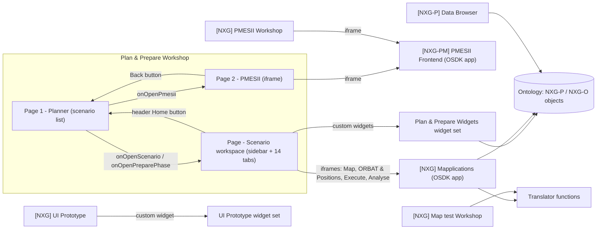
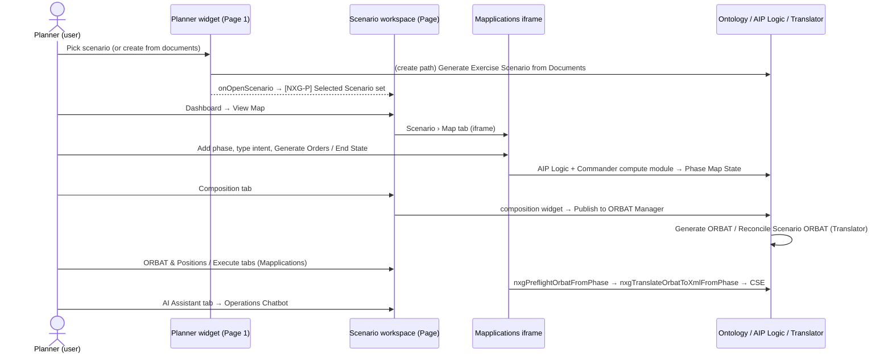

# CSP Workshop Modules — JSON Definitions, Descriptions & Wiring

> Companion to [`CSP_PROJECT_OVERVIEW.md`](./CSP_PROJECT_OVERVIEW.md).
> **Snapshot date:** 2026-11-01, main branch of each module.

## About the JSON in this document

Foundry does not expose a Workshop module's raw internal save format through the tools used to write this
document. Each module was read as its **Workshop DSL definition** and then **converted by hand into the
structured JSON below**. The JSON keeps everything that matters for understanding and rebuilding the module:

* pages, sections, tabs and layout
* widgets: type, editor label, widget id, inputs and outputs
* variables: type, default values and how they are derived (object-set definitions, link traversals, function-backed variables)
* events: page/tab navigation and actions

It leaves out cosmetic defaults such as export timezone settings and "fit columns" flags. Where the
Workshop exporter could not represent part of the configuration, the JSON shows
`"<unsupported-in-export>"`. This affects iframe URL paths, iframe bidirectional field mappings and the
AIP agent reference.

**This JSON is a readable description of each module. Workshop cannot import it.**

### Modules covered

| # | Module | RID | Folder | Role |
|---|---|---|---|---|
| 1 | **Plan & Prepare** | `ri.workshop.main.module.8bfbb4f7-c40b-46c7-9bab-0def4c809f80` | `3. Applications/Plan & Prepare` | **Main CSP user interface.** Shell around custom widgets and the Mapplications app |
| 2 | [NXG-P] Plan and Prepare Data Browser (WIP) | `ri.workshop.main.module.e6add568-f3ab-4cc4-b22e-a9444ec7d082` | `2. Ontology/Plan And Prepare/Object Types` | Admin/debug object tables for the `[NXG-P]` types |
| 3 | [NXG] Map test Workshop | `ri.workshop.main.module.c8587b80-0304-413b-b1eb-0d5fad85c0ff` | `3. Applications/Mapplications` | Test harness: pick an Operation and render Translator output |
| 4 | [NXG] UI Prototype | `ri.workshop.main.module.593a9fd4-ee57-464c-afdc-2797c24e47e1` | `0. Prototyping` | Early prototype (custom widget only) |
| 5 | [NXG] PMESII Workshop | `ri.workshop.main.module.da53844d-a252-4736-8575-96c7a55fc647` | `PMESII/Applications` | Full-screen wrapper around the PMESII frontend |

---

## 0. How the Workshops fit together



**Main pattern:** the **Plan & Prepare** Workshop is mostly a *shell*. It provides the dark-themed page
frame, a custom sidebar, a custom header and tab-based navigation. The real UI lives in two places:

1. **Custom widgets** from the *Plan & Prepare Widgets* widget set
   (`ri.widgetregistry..widget-set.dcda86f7-09a6-4ca8-8d36-3f98e2dbe788`). These are React widgets that
   read and write the `[NXG-P]` ontology through OSDK.
2. **The [NXG] Mapplications OSDK app** (`ri.third-party-applications.main.application.01d93c11-77d8-46c4-bca9-3158bd5ff581`).
   It is embedded through bidirectional iframes, each pointing at a different static route: map, ORBAT,
   execute and analyse.

Most business logic (AI generation, orders, end-state resolution, ORBAT publishing) runs inside those
widgets and the Mapplications app, not in Workshop variables or events.

---

## 1. Plan & Prepare (main application)

**RID:** `ri.workshop.main.module.8bfbb4f7-c40b-46c7-9bab-0def4c809f80`

### 1.1 Description
This is the CSP front door. Users land on **Page 1 (Planner)**, a custom widget that lists every
scenario and lets the user pick or create one. Picking a scenario opens **Page (Scenario workspace)**.
The workspace has:

* a 200 px collapsible custom sidebar titled **"CSE 2.0"**, with 13 items
* a custom header showing the selected tab's name and a **Home** button
* a **tabbed section with the tab headers hidden**. The sidebar drives the active tab through the
  `[s] selected sidebar tab` variable (`activeTabDisplayName` is bound to it).

The PMESII deep-dive opens on **Page 2**, which iframes the PMESII Frontend and has a **Back** button.

### 1.2 Navigation model

| Trigger | Effect |
|---|---|
| Planner `onOpenScenario` | Open **Page** (scenario workspace) |
| Planner `onOpenPreparePhase` | Open **Page** (scenario workspace) |
| Planner `onOpenPmesii` | Open **Page 2** (PMESII) |
| Custom header `buttonClicked` (Home) | Open **Page 1** (Planner) |
| Page 2 "Back" button | Open **Page 1** |
| Sidebar item click | Writes `[s] selected sidebar tab`, which switches the tab in the workspace |
| Scenario Dashboard `onViewMap` | Open the **Scenario** tab (its first inner tab is the Map) |
| Scenario Dashboard `onViewTasks` | Open the **Task Management** tab |
| Scenario Dashboard `onViewPhases` | Open the **Phases** tab |
| Scenario Dashboard `onOpenChatbot` | Open the **AI Assistant** tab |

### 1.3 Workspace tabs → content

| Tab (display name) | Widget | Kind | Input bound |
|---|---|---|---|
| Dashboard | `scenarioDashboard` v4.4.0 | Custom widget | `scenario` ← `[NXG-P] Selected Scenario` |
| Scenario › Map | Iframe 1 → Mapplications (static path) | Iframe | — |
| Scenario › Overview | `scenario` v4.0.79 | Custom widget | `scenario` ← `[NXG-P] Selected Phase` |
| Phases | `phasesWidget` v4.4.0 | Custom widget | `scenario` ← Selected Scenario, `selectedPhase` ← Selected Phase |
| Task Management | `taskAssignment` v4.2.0 | Custom widget | `scenario` ← Selected Phase |
| Training Audience | `trainingAudience` v4.2.0 | Custom widget | `scenario` ← Selected Phase |
| Composition | `composition` v0.7.9 | Custom widget | — |
| PMSEII Variables | `pmesiiAnalysis` v4.2.0 | Custom widget | `scenario` ← Selected Phase |
| Exercise Area | *(empty section)* | — | — |
| MIL & MEL | `milMel` v4.2.0 | Custom widget | — |
| ORBAT & Positions | Iframe 2 → Mapplications (static path) | Iframe | — |
| Training Objectives | `trainingObjectives` v4.2.0 | Custom widget | `scenario` ← Selected Phase |
| AI Assistant | AIP Agent chatbot (Operations Chatbot) | AIP Agent widget | — |
| Execute | Iframe 6 → Mapplications (static path) | Iframe | — |
| Analyse | Iframe 7 → Mapplications (static path) | Iframe | — |

### 1.4 JSON definition

```json
{
  "module": {
    "name": "Plan & Prepare",
    "rid": "ri.workshop.main.module.8bfbb4f7-c40b-46c7-9bab-0def4c809f80",
    "moduleHeader": "default (hidden)",
    "scenarios": { "enableScenariosV1": false, "enableScenariosV2": false },
    "homePageId": "a0270544-33f9-3be7-5677-c1bad3ae9e26"
  },
  "variables": [
    { "id": "0516a7ab-94c7-328f-f0a3-e471728e4a6b", "name": "[s] Header Icon", "type": "string", "default": "shield" },
    { "id": "26295ee0-1b6e-f99d-57b3-f70fc25c2aec", "name": "[s] Sidebar Tab Names", "type": "list<string>",
      "default": ["Dashboard", "Scenario", "Phases", "Task Management", "Training Audience", "Composition", "PMSEII Variables", "Training Objectives", "MIL & MEL", "ORBAT & Positions", "Execute", "Analyse", "AI Assistant"] },
    { "id": "89911f86-bdb6-97a0-de0f-8935e4979c08", "name": "Custom Sidebar undefined", "type": "list<string>", "purpose": "sidebar item icons",
      "default": ["dashboard", "map", "flow-branch", "many-to-one", "people", "document", "globe", "chart", "calendar", "diagram-tree", "run-history", "series-search", "predictive-analysis"] },
    { "id": "c4278269-bb6c-a9d2-be0a-d0fbd65d20a7", "name": "Custom Sidebar undefined1", "type": "string", "purpose": "sidebar title", "default": "CSE 2.0" },
    { "id": "d67b35d9-e39c-8c17-9c5f-eee83a1f9ed1", "name": "[s] selected sidebar tab", "type": "string", "default": "Dashboard",
      "writtenBy": ["Custom Sidebar.selectedItem"], "readBy": ["Custom Header.title", "Workspace tabbed section.activeTabDisplayName"] },
    { "id": "a32bca04-7cfd-d415-1c7e-cdedbfb9590c", "name": "[s] Header Buttons", "type": "list<string>", "default": ["Home"] },
    { "id": "8695cf00-0573-4a8a-b5a8-75efb31cd1a0", "name": "[s] Header Button Icons", "type": "list<string>", "default": ["home"] },
    { "id": "7a92140a-be62-8950-8335-1bfe60f670d2", "name": "[b] True", "type": "boolean", "default": true },
    { "id": "8a917a34-8bc5-c99a-fd12-ddc0652de78b", "name": "[b] False", "type": "boolean", "default": false },
    { "id": "a5009f52-9812-5ca1-7748-18efc3086dab", "name": "[b] Mock Data?", "type": "boolean", "default": true, "usedBy": [] },
    { "id": "72f4b6bc-aa97-2f13-dd59-93cb15e26167", "name": "[s] Operation Name", "type": "string", "default": "OP-BALTIC-SHIELD-2026", "usedBy": [] },
    { "id": "5b520837-9fcd-5429-adbb-156e37f485ea", "name": "[s] Output orbat", "type": "string", "default": null },
    { "id": "fff2ecd4-a8a5-7c59-68df-33089bd0f9cc", "name": "var", "type": "string", "kind": "variableTransformation",
      "logic": "if [b] False then [s] Output orbat else [s] Output orbat" },
    { "id": "a00498ef-9523-bf6a-3569-cf279424dce7", "name": "Iframe 2 undefined2", "type": "string", "kind": "function",
      "function": { "rid": "ri.function-registry.main.function.9decf95d-c95d-4bc8-b2d9-7a1f798e60e1", "name": "translate_orbat_from_json", "version": "0.3.1",
                    "inputs": { "ontology_json": "var" } } },
    { "id": "0ec1b40d-9053-69c8-6ade-e243f9b9d013", "name": "[NXG-P] Selected Scenario", "type": "objectSet<[NXG-P] Scenario>",
      "definition": { "base": "pdvwbiwn.nxg-scenario-bf310667", "transforms": [] },
      "writtenBy": ["Planner.selectedScenario"], "readBy": ["Scenario Dashboard.scenario", "Phases widget.scenario"] },
    { "id": "0ec0e6f6-9206-93b3-1e56-d3c6385e94dd", "name": "[NXG-P] All Scenarios", "type": "objectSet<[NXG-P] Scenario>", "definition": "unbound (constrained object set)",
      "readBy": ["Planner.scenarios"] },
    { "id": "4327eb1a-25f7-433b-2334-b1fdda7b98a9", "name": "Selected Scenario", "type": "objectSet<[NXG-P] Scenario>", "definition": "unbound (constrained object set)" },
    { "id": "5ebff705-6256-0921-a80c-a7153c995bc6", "name": "[NXG-P] Selected Phase", "type": "objectSet<[NXG-P] Phase>",
      "definition": { "input": "Selected Scenario", "transforms": [ { "linkTraversal": { "relation": "pdvwbiwn.nxg-scenario-has-phases", "side": "SOURCE", "to": "pdvwbiwn.nxg-phase-2c100d65" } } ] },
      "readBy": ["Phases widget.selectedPhase", "scenario.scenario", "taskAssignment.scenario", "trainingAudience.scenario", "pmesiiAnalysis.scenario", "trainingObjectives.scenario"] }
  ],
  "widgets": [
    { "id": "3bccf830-347d-41c4-b049-44733866adf2", "label": "Planner", "type": "customWidget",
      "widgetSet": "ri.widgetregistry..widget-set.dcda86f7-09a6-4ca8-8d36-3f98e2dbe788", "customWidgetId": "planner", "version": "4.4.0",
      "parameters": { "scenarios": "[NXG-P] All Scenarios", "selectedScenario": "[NXG-P] Selected Scenario" },
      "events": { "onOpenScenario": "OPEN_PAGE Page", "onOpenPreparePhase": "OPEN_PAGE Page", "onOpenPmesii": "OPEN_PAGE Page 2" } },
    { "id": "60a5c65a-dfe3-4797-b48b-5f4e9d64b0c2", "label": "Custom Sidebar", "type": "customWidget", "customWidgetId": "customSidebar", "version": "4.4.0",
      "parameters": { "itemIcons": "Custom Sidebar undefined", "itemLabels": "[s] Sidebar Tab Names", "selectedItem": "[s] selected sidebar tab",
                      "sidebarIcon": "[s] Header Icon", "showCollapseToggle": "[b] True", "sidebarTitle": "Custom Sidebar undefined1" },
      "events": { "collapseToggled": [] } },
    { "id": "02e90812-99a3-486d-aabb-f6e63282ae82", "label": "Custom widget 3 (Header)", "type": "customWidget", "customWidgetId": "customHeader", "version": "4.4.0",
      "parameters": { "title": "[s] selected sidebar tab", "buttonLabels": "[s] Header Buttons", "buttonIcons": "[s] Header Button Icons" },
      "events": { "buttonClicked": "OPEN_PAGE Page 1" } },
    { "id": "eb8914e9-162b-4d1f-8e7b-8c8fe30794ce", "label": "Custom widget 11 (Scenario Dashboard)", "type": "customWidget", "customWidgetId": "scenarioDashboard", "version": "4.4.0",
      "parameters": { "scenario": "[NXG-P] Selected Scenario" },
      "events": { "onViewMap": "OPEN_TAB Scenario", "onViewTasks": "OPEN_TAB Task Management", "onViewPhases": "OPEN_TAB Phases", "onOpenChatbot": "OPEN_TAB AI Assistant" } },
    { "id": "2502b5be-3dcd-45b4-81fe-fafdf06edd3a", "label": "Custom widget 5 (Scenario overview)", "type": "customWidget", "customWidgetId": "scenario", "version": "4.0.79",
      "parameters": { "scenario": "[NXG-P] Selected Phase" } },
    { "id": "d538f548-fd9e-4a39-bcf8-a3ec5ee57956", "label": "Custom widget 12 (Phases)", "type": "customWidget", "customWidgetId": "phasesWidget", "version": "4.4.0",
      "parameters": { "scenario": "[NXG-P] Selected Scenario", "selectedPhase": "[NXG-P] Selected Phase" } },
    { "id": "c73fb0c4-4aaa-407f-9b6c-2138f0ff5b71", "label": "Custom widget 8 (Task Assignment)", "type": "customWidget", "customWidgetId": "taskAssignment", "version": "4.2.0",
      "parameters": { "scenario": "[NXG-P] Selected Phase" } },
    { "id": "acae6da1-a68a-48ce-bf8d-1feaaad55b71", "label": "Custom widget 9 (Training Audience)", "type": "customWidget", "customWidgetId": "trainingAudience", "version": "4.2.0",
      "parameters": { "scenario": "[NXG-P] Selected Phase" } },
    { "id": "6f48e088-752b-4d32-93dd-5b69fc972496", "label": "Custom widget 11 (Composition)", "type": "customWidget", "customWidgetId": "composition", "version": "0.7.9",
      "parameters": {} },
    { "id": "867b8ad2-4a3b-408b-be5b-cb66aa90bedf", "label": "Custom widget 6 (PMESII Analysis)", "type": "customWidget", "customWidgetId": "pmesiiAnalysis", "version": "4.2.0",
      "parameters": { "scenario": "[NXG-P] Selected Phase" } },
    { "id": "95243cd1-0510-457e-a023-02892e793128", "label": "Custom widget 2 (MIL & MEL)", "type": "customWidget", "customWidgetId": "milMel", "version": "4.2.0",
      "parameters": {} },
    { "id": "d2e5ae7a-919b-4d52-a557-f4d3c7aad35e", "label": "Custom widget 10 (Training Objectives)", "type": "customWidget", "customWidgetId": "trainingObjectives", "version": "4.2.0",
      "parameters": { "scenario": "[NXG-P] Selected Phase" } },
    { "id": "dd47e892-73ec-4562-ab13-7206a376d3fd", "label": "Operation AIP Chatbot", "type": "aipChatbotWidget",
      "agent": "<unsupported-in-export> (Operations Chatbot)",
      "sessions": { "showReasoningProcessWhileLoading": true, "hideSessionHistory": false, "createNewSessionOnMount": false } },
    { "id": "c4bec8c1-c6a2-43cd-ac01-cac60e9a88e3", "label": "Iframe 1 (Map)", "type": "iframe", "mode": "bidirectional",
      "src": { "devConsoleApp": "ri.third-party-applications.main.application.01d93c11-77d8-46c4-bca9-3158bd5ff581", "path": "<unsupported-in-export>" }, "fields": "<unsupported-in-export>" },
    { "id": "c37abe66-98b1-4e75-9a80-acfe37532ac2", "label": "Iframe 2 (ORBAT & Positions)", "type": "iframe", "mode": "bidirectional",
      "src": { "devConsoleApp": "ri.third-party-applications.main.application.01d93c11-77d8-46c4-bca9-3158bd5ff581", "path": "<unsupported-in-export>" }, "fields": "<unsupported-in-export>" },
    { "id": "70ca60d6-c7a9-4346-9180-43c6e0a31473", "label": "Iframe 6 (Execute)", "type": "iframe", "mode": "bidirectional",
      "src": { "devConsoleApp": "ri.third-party-applications.main.application.01d93c11-77d8-46c4-bca9-3158bd5ff581", "path": "<unsupported-in-export>" }, "fields": "<unsupported-in-export>" },
    { "id": "42f1924b-8f43-49e9-857f-6e0139d7b535", "label": "Iframe 7 (Analyse)", "type": "iframe", "mode": "bidirectional",
      "src": { "devConsoleApp": "ri.third-party-applications.main.application.01d93c11-77d8-46c4-bca9-3158bd5ff581", "path": "<unsupported-in-export>" }, "fields": "<unsupported-in-export>" },
    { "id": "37fe9437-e388-4ffc-9307-ec095d12a5c3", "label": "Iframe 6 (duplicate, not placed)", "type": "iframe", "mode": "bidirectional",
      "src": { "devConsoleApp": "ri.third-party-applications.main.application.01d93c11-77d8-46c4-bca9-3158bd5ff581", "path": "<unsupported-in-export>" }, "placed": false },
    { "id": "21057a47-cdb8-4630-94f4-cb3d034c635d", "label": "Iframe 5 (PMESII Frontend)", "type": "iframe", "mode": "bidirectional",
      "src": { "devConsoleApp": "ri.third-party-applications.main.application.99104577-3f15-4225-ab34-f226e0b842d1" }, "fields": "<unsupported-in-export>" },
    { "id": "182b3422-3824-4db3-98f4-26e97f79c8fe", "label": "Button group 1", "type": "buttonGroup",
      "buttons": [ { "text": "Back", "onClick": "OPEN_PAGE Page 1" } ] }
  ],
  "pages": [
    { "id": "a0270544-33f9-3be7-5677-c1bad3ae9e26", "name": "Page 1", "userDefinedId": "page-1", "isHome": true,
      "layout": { "hstack": [ { "section": "93b9213c-0037-4829-9680-dd4dcc4d9969", "flex": true, "content": ["Planner"] } ] } },
    { "id": "59bb5f73-90e7-405c-8140-52e6879b9309", "name": "Page", "userDefinedId": "page", "background": "#111418",
      "layout": { "hstack": [ { "section": "2b92e395-736d-4d56-a0c1-85320ad4a985", "content": { "hstack": [
        { "section": "0666ffc5-87fe-4805-b429-e4ae87fc4530", "width": "200px", "resizable": "100-800px", "background": "#111418", "content": ["Custom Sidebar"] },
        { "section": "8b4cdfe7-c0bb-4a04-bf27-1c1a5f4f002a", "flex": true, "background": "#111418", "content": { "vstack": [
          { "box": { "height": "55px" }, "content": ["Custom Header"] },
          { "tabbedSection": "2b9331e6-a4ef-4b85-b9d5-b2d4699acb4e", "headerHeight": 0, "activeTabDisplayName": "[s] selected sidebar tab", "tabs": [
            { "id": "abf3431a-16d7-4484-992e-183768287080", "name": "Dashboard", "content": ["Scenario Dashboard"] },
            { "id": "bff58f93-f702-4b30-af30-c22fb64644c1", "name": "Scenario", "content": { "innerTabs": [
              { "id": "85502176-686c-49d1-af04-f897056ec3aa", "name": "Map", "content": ["Iframe 1 (Map)"] },
              { "id": "16c2435a-c2cc-4799-b9c4-44e19c47ac95", "name": "Overview", "content": ["Scenario overview"] } ] } },
            { "id": "05c2fbf6-63de-40c7-9798-d9058f1c55be", "name": "Phases", "content": ["Phases widget"] },
            { "id": "dd799e7b-eeef-4b97-b1b9-9eb36923f66b", "name": "Task Management", "content": ["Task Assignment"] },
            { "id": "6f5a07b7-995b-4a59-843b-da74b3bcfd1d", "name": "Training Audience", "content": ["Training Audience"] },
            { "id": "58430899-ca5a-41ed-859c-018218afb1c1", "name": "Composition", "content": ["Composition"] },
            { "id": "1e0cec93-7730-4e11-9167-5302ef20a75c", "name": "PMSEII Variables", "content": ["PMESII Analysis"] },
            { "id": "6562f79b-4d56-42f7-88a3-de4bde7592fb", "name": "Exercise Area", "content": [] },
            { "id": "a0dee5c7-18f8-4cbd-8156-eed67fd940a2", "name": "MIL & MEL", "content": ["MIL & MEL"] },
            { "id": "5632d60e-088d-404b-b3f5-c504ab000c30", "name": "ORBAT & Positions", "content": ["Iframe 2 (ORBAT & Positions)"] },
            { "id": "9b7b91eb-106a-46ce-addf-e14c44410199", "name": "Training Objectives", "content": ["Training Objectives"] },
            { "id": "f1732a50-e8e3-4337-b663-7c12fe45c8f7", "name": "AI Assistant", "content": ["Operation AIP Chatbot"] },
            { "id": "a024a82e-c803-4d22-9b84-f8bee33c4e99", "name": "Execute", "content": ["Iframe 6 (Execute)"] },
            { "id": "bc35a76a-0083-4664-b68e-c946edace5a0", "name": "Analyse", "content": ["Iframe 7 (Analyse)"] }
          ] } ] } } ] } } ] } },
    { "id": "4cc37c31-b9b2-12cd-0182-3470d1d7b7c9", "name": "Page 2", "userDefinedId": "page-2",
      "layout": { "section": "729de8e9-ff20-4771-93fb-77ed3b515f44", "header": { "style": "callout/prominent", "color": "#1C2127", "leftComponents": ["Button group 1 (Back)"] },
                  "content": ["Iframe 5 (PMESII Frontend)"] } }
  ]
}
```

### 1.5 Observations & potential issues
1. **The Selected Phase chain may be empty.** `[NXG-P] Selected Phase` is derived from the variable
   **`Selected Scenario`** (id `4327eb1a…`), not from **`[NXG-P] Selected Scenario`**, which is the one the
   Planner writes to. If nothing sets `Selected Scenario`, every widget fed by Selected Phase receives an
   empty set. That covers Overview, Tasks, Training Audience, PMESII and Training Objectives. They
   probably work today by loading their own data, but the binding looks unintentional.
2. **Phase sets are passed into `scenario` parameters.** Several widgets declare a `scenario` parameter
   but are given a Phase object set. Check the widget manifests to confirm what they expect.
3. **The sidebar and the tabs don't match.** The tab *Exercise Area* has no sidebar entry, so it can't be
   reached, and its section is empty. The label "PMSEII" is a typo for PMESII and appears in both the
   sidebar and the tab name. Because tabs are selected by display name, the two spellings must stay
   identical.
4. **Dead variables and widgets.** These are unused: `[b] Mock Data?`, `[s] Operation Name`, `var` (both
   branches return the same value), `Iframe 2 undefined2` (calls `translate_orbat_from_json` v0.3.1 on an
   empty string) and a duplicate "Iframe 6" that is never placed on a page.
5. **Mixed widget-set versions.** The widgets are pinned to 4.4.0, 4.2.0, 4.0.79 and 0.7.9
   (Composition). Old pins, Composition especially, may lack recent fixes.
6. **Variable names.** Sidebar variables have auto-generated names (`Custom Sidebar undefined`,
   `…undefined1`). Renaming them would make the module easier to maintain.

---

## 2. [NXG-P] Plan and Prepare Data Browser (WIP)

**RID:** `ri.workshop.main.module.e6add568-f3ab-4cc4-b22e-a9444ec7d082`

### 2.1 Description
An admin/debug browser over the `[NXG-P]` object types, with **one object table per page**. A module
header button bar (8 buttons, all labelled "Button") switches between pages. The Scenario page has a
**delete** button that runs *Delete [NXG-P] Scenario*. It is marked **WIP**: buttons are unlabelled, the
selection variables are not consumed anywhere, and a "Create Scenario" button group is defined but not
placed. It is useful for checking raw data the AI has generated, and for cleanup such as removing
duplicate draft scenarios.

### 2.2 JSON definition

```json
{
  "module": {
    "name": "[NXG-P] Plan and Prepare Data Browser (WIP)",
    "rid": "ri.workshop.main.module.e6add568-f3ab-4cc4-b22e-a9444ec7d082",
    "moduleHeader": { "logo": { "icon": "application", "color": "#8F99A8" }, "orientation": "horizontal", "height": 50, "startComponents": ["Button group 2"] },
    "homePageId": "a700c520-5f88-42cb-b921-3cd5ddfc864f"
  },
  "variables": [
    { "id": "3b4911fa-c659-8449-05ad-4e7e81b96086", "name": "[NXG-P] Scenario", "type": "objectSet", "base": "pdvwbiwn.nxg-scenario-bf310667" },
    { "id": "df639409-895e-cf50-eca1-014f70cdd3d8", "name": "[NXG-P] Task", "type": "objectSet", "base": "pdvwbiwn.nxg-task-580166e1" },
    { "id": "d5d7b298-51e2-f478-4f8b-bfbf7b4e85d5", "name": "[NXG-P] Phase", "type": "objectSet", "base": "pdvwbiwn.nxg-phase-2c100d65" },
    { "id": "77a7641c-21d6-b17d-b175-a8a0995c9264", "name": "[NXG-P] Inject", "type": "objectSet", "base": "pdvwbiwn.nxg-inject-f3baa249" },
    { "id": "48c939e8-837f-c12b-3b7b-3e0f3f08617d", "name": "[NXG-P] Training Objective", "type": "objectSet", "base": "pdvwbiwn.nxg-training-objective-29f4e616" },
    { "id": "93fcba10-7277-8346-4b3d-e87e957bada9", "name": "[NXG-P] Phase Map State", "type": "objectSet", "base": "pdvwbiwn.nxg-phase-map-state-e235fc2b" },
    { "id": "4cf6332a-0fe5-06ec-c4af-18ab35dc746f", "name": "[NXG-P] PMESII Domain", "type": "objectSet", "base": "pdvwbiwn.nxg-pmesii-domain-1f6ec101" },
    { "id": "35e7d238-2d1c-ddce-0f73-bccf8f7297b3", "name": "[NXG-P] Training Audience", "type": "objectSet", "base": "pdvwbiwn.nxg-training-audience-223a182d" },
    { "name": "Object table 1..8 Active object", "type": "objectSet", "note": "8 active-object outputs, one per table; not consumed" }
  ],
  "widgets": [
    { "id": "4069853b-cbe5-4308-9f51-da93217efdff", "label": "[NXG-P] Scenario Object table", "type": "objectTable", "input": "[NXG-P] Scenario", "rowLines": 4,
      "columns": ["Title", "AI Generated", "Current Phase", "Scenario Type", "Strategic Context Body", "Created Date", "Overall Progress (%)", "Classification", "Status", "Source Documents", "Strategic Context Title", "Name", "Overall Progress (%) [dup]", "Scenario ID"],
      "activeObject": "Object table 1 Active object" },
    { "id": "15ea18e5-5863-463a-93db-fe052f5c38c2", "label": "[NXG-P] Task Object table", "type": "objectTable", "input": "[NXG-P] Task", "defaultSort": "task-name asc",
      "columns": ["Title", "Assigned To Person ID", "Description", "AI Assisted", "Due Offset", "Approved By Person ID", "Status", "Section", "Name", "Phase ID", "Scenario ID", "Task ID"] },
    { "id": "500a5f41-6470-4608-9804-8d139398bed1", "label": "[NXG-P] Phase Object table", "type": "objectTable", "input": "[NXG-P] Phase",
      "columns": ["Title", "Description", "Objective Statement", "Start Offset", "Sequence Number", "Status", "End Offset", "Name", "Phase ID", "Scenario ID", "Name [dup]"] },
    { "id": "a0d51249-d7e7-4c08-b1c5-226a63794085", "label": "[NXG-P] Inject Object table", "type": "objectTable", "input": "[NXG-P] Inject",
      "columns": ["Title", "Body", "Terrain Feature Reference", "Expected Response", "Category", "Day Offset"] },
    { "id": "cc9489dc-bbda-4196-853f-3953d0fdc1d1", "label": "[NXG-P] Training Objective Object table", "type": "objectTable", "input": "[NXG-P] Training Objective",
      "columns": ["Title", "Functional Area", "Reference", "Priority", "Objective", "Reference [dup]", "Phase ID", "Scenario ID", "Objective ID"] },
    { "id": "9115bd36-b6f8-4560-a828-54fb5aa50893", "label": "[NXG-P] Phase Map State Object table", "type": "objectTable", "input": "[NXG-P] Phase Map State",
      "columns": ["Title", "Start State Map Json", "End State Map Json", "Phase Id", "Map State ID"] },
    { "id": "5d493c1c-1a6f-4766-9978-b2772cb4f3bd", "label": "[NXG-P] PMESII Domain Object table", "type": "objectTable", "input": "[NXG-P] PMESII Domain",
      "columns": ["Title", "Status", "AI Generated", "Value", "Domain ID", "Scenario ID"] },
    { "id": "5019b218-a9e2-4a2a-bdef-5f2db004de56", "label": "[NXG-P] Training Audience Object table", "type": "objectTable", "input": "[NXG-P] Training Audience",
      "columns": ["Title", "Description", "Participant Count", "Directorates", "Audience Type", "Name", "Audience ID", "Scenario ID"] },
    { "id": "97eb16d2-955f-4312-9dc6-a5bc5260840a", "label": "Button group 3", "type": "buttonGroup",
      "buttons": [ { "text": "delete", "onClick": { "action": "ri.actions.main.action-type.bbd0c3b5-012d-45bd-a39a-afb2f2777242", "actionName": "Delete [NXG-P] Scenario", "layout": "FORM" } } ] },
    { "id": "104d7b84-05d4-4d3b-b764-77ad92c28ff6", "label": "[NXG-P] Scenario Button group", "type": "buttonGroup", "placed": false,
      "buttons": [ { "text": "Button", "onClick": { "action": "ri.actions.main.action-type.fc578623-548d-4e3d-9729-3cc5420855c8", "actionName": "Create [NXG-P] Scenario", "outputObjectSet": "[NXG-P] Scenario" } } ] },
    { "id": "6317a51f-8622-4407-ae39-72328f2e9c72", "label": "Button group 2 (module header nav)", "type": "buttonGroup",
      "buttons": [
        { "text": "Button", "onClick": "OPEN_PAGE Page (Scenario)" },
        { "text": "Button", "onClick": "OPEN_PAGE Page 1 (Task)" },
        { "text": "Button", "onClick": "OPEN_PAGE Page 2 (Phase)" },
        { "text": "Button", "onClick": "OPEN_PAGE Page 3 (Inject)" },
        { "text": "Button", "onClick": "OPEN_PAGE Page 4 (Training Objective)" },
        { "text": "Button", "onClick": "OPEN_PAGE Page 5 (Phase Map State)" },
        { "text": "Button", "onClick": "OPEN_PAGE Page 6 (PMESII Domain)" },
        { "text": "Button", "onClick": "OPEN_PAGE Page 7 (Training Audience)" } ] }
  ],
  "pages": [
    { "id": "a700c520-5f88-42cb-b921-3cd5ddfc864f", "name": "Page", "isHome": true, "content": ["[NXG-P] Scenario Object table"], "sectionHeaderLeft": ["Button group 3 (delete)"] },
    { "id": "0ad5d752-8ada-d702-f3bb-1d848411ca21", "name": "Page 1", "content": ["[NXG-P] Task Object table"] },
    { "id": "90c5cf5c-7fb9-27b9-90de-a32155724af7", "name": "Page 2", "content": ["[NXG-P] Phase Object table"] },
    { "id": "a633aa18-77fe-483e-1e38-5295e652d52c", "name": "Page 3", "content": ["[NXG-P] Inject Object table"] },
    { "id": "eafbd516-7d98-d3a1-b0e6-9b89a2fee1fc", "name": "Page 4", "content": ["[NXG-P] Training Objective Object table"] },
    { "id": "8f97a054-0df6-80b9-6feb-2195877e2db5", "name": "Page 5", "content": ["[NXG-P] Phase Map State Object table"] },
    { "id": "00f6b233-0e26-86ca-007a-16cc13a8d224", "name": "Page 6", "content": ["[NXG-P] PMESII Domain Object table"] },
    { "id": "bcf641c7-4c67-3a57-4159-29b786edbbcb", "name": "Page 7", "content": ["[NXG-P] Training Audience Object table"] }
  ]
}
```

### 2.3 Observations
* The delete button does not pass the selected scenario into the action, so the user has to pick it again
  in the form. Binding `nxgScenario` to `Object table 1 Active object` would make it one click.
* All navigation buttons are labelled "Button". Label them with the object type names.
* Several tables show the same column twice (Scenario › Overall Progress, Phase › Name, Training Objective › Reference).
* Newer `[NXG-P]` types are not covered: Subtask, Participating Nation, OPFOR Definition and Composition.
* The module sits in an *Object Types* folder. `3. Applications` would be a better home.

---

## 3. [NXG] Map test Workshop

**RID:** `ri.workshop.main.module.c8587b80-0304-413b-b1eb-0d5fad85c0ff`

### 3.1 Description
A two-pane harness for the Translator. The left pane (300 px) is an object table of `[NXG-O] Operation`;
the first row is selected automatically. The selected operation's primary key goes into a
**function-backed variable** that calls a Translator function. The returned string (ORBAT JSON) is shown
in a Markdown widget on the right.

### 3.2 JSON definition

```json
{
  "module": { "name": "[NXG] Map test Workshop", "rid": "ri.workshop.main.module.c8587b80-0304-413b-b1eb-0d5fad85c0ff", "homePageId": "212f84b1-b899-4240-8b52-493b5a4e72de" },
  "variables": [
    { "id": "0b20a6b1-00bb-d689-4c3a-b993b374dbb6", "name": "[NXG] Operation", "type": "objectSet", "base": "pdvwbiwn.id-c4ef3133-9204-2eb2-a9c2-ca2ed75c279f" },
    { "id": "044eaa40-96ef-15d3-e235-ab079d446a5f", "name": "Object table 1 Active object", "type": "objectSet", "writtenBy": ["[NXG] Operation Object table.activeObject"] },
    { "id": "6ca22a4f-6a8b-2754-77d9-b49ffeb6128e", "name": "[s] Selected Op", "type": "string", "kind": "objectProperty",
      "source": { "objectSet": "Object table 1 Active object", "property": "primary_key" } },
    { "id": "9abf2180-3959-8eec-b176-b3fe83faa9c7", "name": "Markdown 1 Variable", "type": "string", "kind": "function",
      "function": { "rid": "ri.function-registry.main.function.ab0dbd4a-a099-48d1-99d5-8437fff9cddb", "name": "generate_vbs4_orbat", "version": "0.1.4",
                    "inputs": { "operation_key": "[s] Selected Op" } } }
  ],
  "widgets": [
    { "id": "53f44a50-af77-41d9-95e7-73be42b11e29", "label": "[NXG] Operation Object table", "type": "objectTable", "input": "[NXG] Operation",
      "activeObject": "Object table 1 Active object", "autoSelect": true },
    { "id": "a86cba90-ad02-405a-9ea3-69cd8aa11f8c", "label": "Markdown 1", "type": "markdown", "input": "Markdown 1 Variable",
      "display": { "scrolling": true, "breakNewlines": true, "longWordWrap": true } }
  ],
  "pages": [
    { "id": "212f84b1-b899-4240-8b52-493b5a4e72de", "name": "Page", "isHome": true,
      "layout": { "hstack": [ { "box": { "width": "300px" }, "content": ["[NXG] Operation Object table"] }, { "flex": true, "content": ["Markdown 1"] } ] } }
  ]
}
```

### 3.3 Observations
* It calls **`generate_vbs4_orbat` v0.1.4**, a legacy function that no longer exists in the Translator
  source. To test current behaviour, repoint it to `translate_orbat_from_operation`, or to
  `translate_orbat_to_xml_from_operation` / `preflight_orbat_from_operation`.
* A Markdown widget is a poor fit for raw JSON or XML. Wrapping the output in a fenced code block, or
  using a code/text widget, would make it easier to read.

---

## 4. [NXG] UI Prototype

**RID:** `ri.workshop.main.module.593a9fd4-ee57-464c-afdc-2797c24e47e1`

### 4.1 Description
An early prototype. A single page shows one custom widget, *"NATO NextGen Exercise Planner"*, from the
prototype widget set. A second copy of the widget is defined but not placed. It has no variables or
events. This is where Plan & Prepare started; it was later replaced by the Plan & Prepare Widgets set.

### 4.2 JSON definition

```json
{
  "module": { "name": "[NXG] UI Prototype", "rid": "ri.workshop.main.module.593a9fd4-ee57-464c-afdc-2797c24e47e1", "homePageId": "e8aa2bad-6d43-4b9c-955b-8a6b63272ccb" },
  "variables": [],
  "widgets": [
    { "id": "66f9c4a5-da5f-4e33-9b98-6f4b7b5bced6", "label": "NATO NextGen Exercise Planner", "type": "customWidget",
      "widgetSet": "ri.widgetregistry..widget-set.daece645-c2b5-47c6-9bd2-7d4339c7a84e", "customWidgetId": "widgetId", "version": "0.0.7", "parameters": {}, "events": {} },
    { "id": "f8dadca4-24b9-46a3-a291-5152de4daec3", "label": "NATO NextGen Exercise Planner (copy)", "type": "customWidget",
      "widgetSet": "ri.widgetregistry..widget-set.daece645-c2b5-47c6-9bd2-7d4339c7a84e", "customWidgetId": "widgetId", "version": "0.0.7", "placed": false }
  ],
  "pages": [
    { "id": "e8aa2bad-6d43-4b9c-955b-8a6b63272ccb", "name": "Page", "isHome": true, "layout": { "hstack": [ { "flex": true, "content": ["NATO NextGen Exercise Planner"] } ] } }
  ]
}
```

---

## 5. [NXG] PMESII Workshop

**RID:** `ri.workshop.main.module.da53844d-a252-4736-8575-96c7a55fc647`

### 5.1 Description
A single full-page bidirectional iframe around the **`[NXG-PM] PMESII Frontend`** OSDK app
(`ri.third-party-applications.main.application.99104577-3f15-4225-ab34-f226e0b842d1`). Page 2 of
Plan & Prepare embeds the same app. This Workshop lets PMESII be opened on its own, outside a CSP scenario.

### 5.2 JSON definition

```json
{
  "module": { "name": "[NXG] PMESII Workshop", "rid": "ri.workshop.main.module.da53844d-a252-4736-8575-96c7a55fc647", "homePageId": "c54e98b9-80cc-401e-aa1b-1e9339f3cb0b" },
  "variables": [],
  "widgets": [
    { "id": "06ba49ff-485a-4f0c-8094-acf339d8bf6b", "label": "Iframe 1", "type": "iframe", "mode": "bidirectional",
      "src": { "devConsoleApp": "ri.third-party-applications.main.application.99104577-3f15-4225-ab34-f226e0b842d1" }, "fields": "<unsupported-in-export>" }
  ],
  "pages": [
    { "id": "c54e98b9-80cc-401e-aa1b-1e9339f3cb0b", "name": "Page", "isHome": true, "layout": { "hstack": [ { "flex": true, "content": ["Iframe 1"] } ] } }
  ]
}
```

---

## 6. Cross-module wiring reference

### 6.1 Ontology objects touched by each module

| Module | Reads | Writes |
|---|---|---|
| Plan & Prepare | Scenario, Phase (via variables); everything else through custom widgets and Mapplications | Through custom widgets, Mapplications and the AI agent (actions & AIP Logic) |
| Data Browser | Scenario, Task, Phase, Inject, Training Objective, Phase Map State, PMESII Domain, Training Audience | Scenario (delete; create is wired but not placed) |
| Map test | Operation (+ Units/Hierarchies/catalogues inside the Translator) | — |
| UI Prototype | (inside widget) | — |
| PMESII Workshop | (inside the PMESII frontend) | — |

### 6.2 Functions and actions referenced directly by Workshop config

| Module | Reference | Kind | Note |
|---|---|---|---|
| Plan & Prepare | `translate_orbat_from_json` v0.3.1 (`ri.function-registry.main.function.9decf95d-…`) | Function variable | Not consumed by any widget |
| Map test | `generate_vbs4_orbat` v0.1.4 (`ri.function-registry.main.function.ab0dbd4a-…`) | Function variable | Legacy function |
| Data Browser | `Delete [NXG-P] Scenario` (`ri.actions.main.action-type.bbd0c3b5-…`) | Action button | Placed |
| Data Browser | `Create [NXG-P] Scenario` (`ri.actions.main.action-type.fc578623-…`) | Action button | Not placed |

All other function and action calls (`Generate Orders`, `Generate Phase Draft/Map`,
`Generate Exercise Scenario from Documents`, `Generate ORBAT`, `Reconcile Scenario ORBAT`,
`nxgPreflightOrbatFromPhase`, `nxgTranslateOrbatToXmlFromPhase`, CSE-Prep functions, and so on) are made
**from inside the custom widgets and the Mapplications app through OSDK**, not from Workshop
configuration. To trace them, look in the *Plan & Prepare Widgets* repository
(`ri.stemma.main.repository.f8d57d24-dd89-460c-9c6e-ff079b72e9bc`) and the *[NXG] Mapplications Repo*
(`ri.stemma.main.repository.9a08332e-522d-460d-b0d6-14d3c2af70b6`).

### 6.3 Embedded external applications

| Embedded app | Embedded in | Where |
|---|---|---|
| [NXG] Mapplications `…01d93c11…` | Plan & Prepare | Scenario › Map, ORBAT & Positions, Execute, Analyse (4 iframes, different static paths) |
| [NXG-PM] PMESII Frontend `…99104577…` | Plan & Prepare (Page 2), PMESII Workshop | Full page |

### 6.4 Custom widget catalogue (Plan & Prepare Widgets set)

| customWidgetId | Pinned version | Used in tab | Parameters | Events |
|---|---|---|---|---|
| `planner` | 4.4.0 | Page 1 | `scenarios`, `selectedScenario` | `onOpenScenario`, `onOpenPreparePhase`, `onOpenPmesii` |
| `customSidebar` | 4.4.0 | Workspace sidebar | `itemIcons`, `itemLabels`, `selectedItem`, `sidebarIcon`, `showCollapseToggle`, `sidebarTitle` | `collapseToggled` |
| `customHeader` | 4.4.0 | Workspace header | `title`, `buttonLabels`, `buttonIcons` | `buttonClicked` |
| `scenarioDashboard` | 4.4.0 | Dashboard | `scenario` | `onViewMap`, `onViewTasks`, `onViewPhases`, `onOpenChatbot` |
| `scenario` | 4.0.79 | Scenario › Overview | `scenario` | — |
| `phasesWidget` | 4.4.0 | Phases | `scenario`, `selectedPhase` | — |
| `taskAssignment` | 4.2.0 | Task Management | `scenario` | — |
| `trainingAudience` | 4.2.0 | Training Audience | `scenario` | — |
| `composition` | 0.7.9 | Composition | — | — |
| `pmesiiAnalysis` | 4.2.0 | PMSEII Variables | `scenario` | — |
| `milMel` | 4.2.0 | MIL & MEL | — | — |
| `trainingObjectives` | 4.2.0 | Training Objectives | `scenario` | — |

---

## 7. A user's journey through the modules



---

## 8. Suggested clean-up (summary)

1. Bind `[NXG-P] Selected Phase` to `[NXG-P] Selected Scenario`, or remove the orphan `Selected Scenario`
   variable. Then check that each widget receives the object type it expects.
2. Fix the "PMSEII" typo in both the sidebar list and the tab name. Then either add *Exercise Area* to the
   sidebar or remove the tab.
3. Remove the unused variables and widgets in Plan & Prepare (§1.5 item 4).
4. Bring the Plan & Prepare widget versions in line, especially `composition` (0.7.9) and `scenario` (4.0.79).
5. Repoint the Map test Workshop from the legacy `generate_vbs4_orbat` to `translate_*` or `preflight_*` functions.
6. Data Browser: label the buttons, bind the delete action to the selected row, add the missing `[NXG-P]`
   types, and move it to `3. Applications`.
