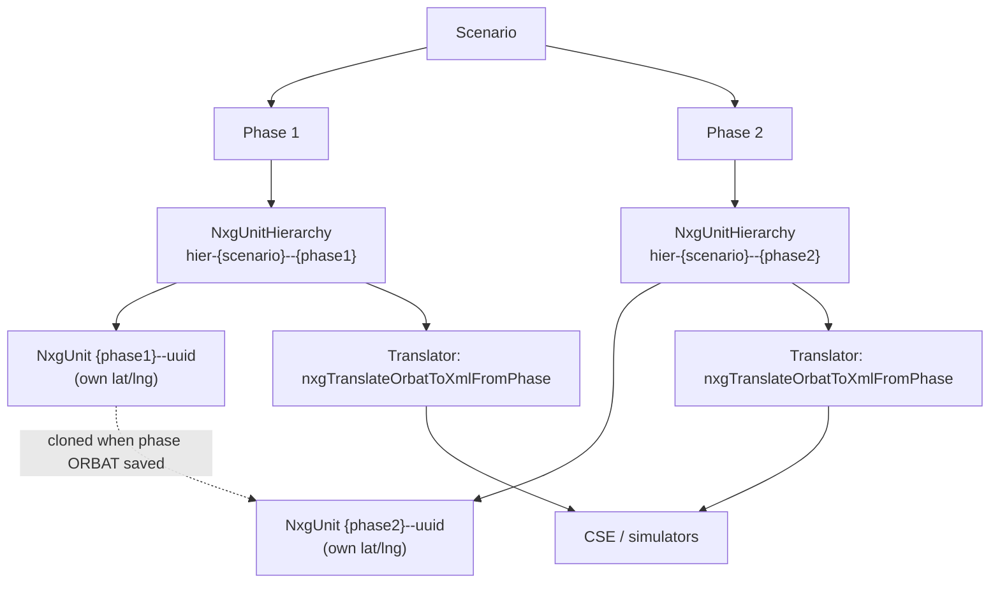
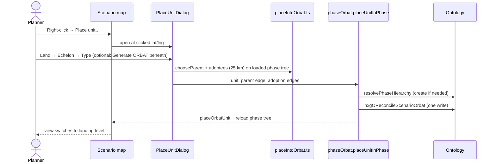
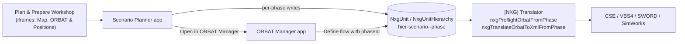

# Mapplications — `per-phase-orbat` Branch Change Log

> Companion to [`CSP_PROJECT_OVERVIEW.md`](./CSP_PROJECT_OVERVIEW.md) and [`CSP_WORKSHOP_MODULES.md`](./CSP_WORKSHOP_MODULES.md).
>
> **Repository:** `[NXG] Mapplications Repo` (`ri.stemma.main.repository.9a08332e-522d-460d-b0d6-14d3c2af70b6`)
> **Branch:** `ai-fde/d.e.kelly/per-phase-orbat`
> **Compared against:** `master` (merge base `015efe59`)
> **Snapshot date:** 2026-11-01

---

## 1. Summary

| Metric | Value |
|---|---|
| Commits ahead of `master` | **21** (18–19 Oct 2026, all by David Kelly) |
| Commits behind `master` | **0** (master has not moved since the branch was cut, so it should merge cleanly) |
| Files changed | **28** |
| Lines | **+2,729 / −213** |
| New files | 17 (pure ORBAT logic + tests, map layer, dialogs, hook, plan doc) |
| Tests added | 6 test files (`orbatLevels`, `phaseKeys`, `placeIntoOrbat`, `ringLayout`, `skeleton`, plus updated generator caps) |

**In one sentence:** the branch moves the Scenario Planner from *one scenario-wide ORBAT* to *one ORBAT per
phase*, and makes that phase ORBAT the source of truth for what is drawn on the map, with a level-by-level
view of the command tree, a "Place unit" dialog that slots units into the tree, subtree drag, a unit
right-click menu, and order inheritance down the chain of command.

### Why it was needed
CSE reads each unit's **position straight off the `NxgUnit` object**. A unit is somewhere different in every
phase, so a single scenario-wide set of units could only ever describe one phase correctly. Giving each phase
its own copy of the units makes the positions exact per phase. It also lines up with the Translator's
phase functions `nxgTranslateOrbatToXmlFromPhase` and `nxgPreflightOrbatFromPhase`, which export and check
one phase's ORBAT at a time.

---

## 2. The data model change

### Before (master)
- One `NxgUnitHierarchy` per scenario (e.g. `hier-scenario_operation_baltic_shield`).
- Units placed on the map were "placements" in the phase map state; each placement could point at a root
  unit in the shared scenario hierarchy.
- Placing a unit automatically wrote a basic ORBAT underneath it.

### After (this branch)
Defined in `src/shared/orbat/phaseKeys.ts`:

| Thing | Key format | Notes |
|---|---|---|
| Phase hierarchy | `hier-{scenarioId}--{phaseId}` | `NxgUnitHierarchy` with `phaseKey` set; created on first use by `resolvePhaseHierarchy` |
| Phase hierarchy name | `{scenarioName} — {phaseName} ORBAT` | |
| Phase unit | `{phaseId}--{uuid}` | `NxgUnit` rows are **copied, not shared**, between phases |
| Separator | `--` | `PHASE_KEY_SEPARATOR` |

Helper functions:
- `phaseHierarchyKey`, `phaseHierarchyName`, `newPhaseUnitKey`
- `isNativeToPhase(unitKey, phaseId)`: true if the unit key starts with `{phaseId}--`
- `partitionPhasePlacements(placements, phaseId)` sorts a phase's placements into:
  - **native**: the ORBAT already lives in this phase
  - **foreign**: the ORBAT belongs to another phase or the legacy scenario hierarchy, so it must be cloned in
  - **missing**: eligible for an ORBAT but has none yet

### Rules agreed in the plan (`docs/PHASE_ORBAT_PLAN.md`)
- The **phase ORBAT is the source of truth** for what is on the map.
- **Levels are absolute in the phase command tree, per side.** Level 0 is the most senior real unit(s) of
  each side; synthetic side-root grouping nodes don't count.
- At level N the map shows the **frontier**: every node at depth N, plus any shallower branch that ends
  (leaf) before N.
- **Land only** for now. The maritime, air and space tabs are shown but disabled.

---

## 3. Plan progress

From `docs/PHASE_ORBAT_PLAN.md` on the branch:

| Step | Description | Status | Commit(s) |
|---|---|---|---|
| 1 | Generator: breadth-first build, echelon-scaled caps | ✅ Done | `00a26cb` |
| 2 | `usePhaseOrbat(hierarchyKey)` hook: load forest + positions, indexed by level | ✅ Done | `d0d60e3` |
| 3 | `orbatLevels.ts`: `indexForest`, `frontierAt`, `translateSubtree` (+ tests) | ✅ Done | `d0d60e3` |
| 4 | Place unit dialog wired to map right-click; parent/adopt write; auto-switch level | ✅ Done | `fb3c333`, `f2a8b7a` |
| 5 | Level control + GeoJSON ORBAT layer; drag moves subtree | ✅ Done | `93fde11` |
| 6 | Right-click on level units: Generate beneath, Change parent, Open in ORBAT Manager | ✅ Done (no Remove) | `9202d29`, `67e8ea3` |
| 7 | Orders on tree nodes + inheritance/conflicts; phase clone of whole tree | 🟡 Partly done | `c3f93b7` (orders + guard) |
| 8 | Clean up legacy scenario-wide paths, palette drag-drop, delete `hier-scenario_operation_baltic_shield` | ⬜ Not started | — |

Outstanding TODOs recorded in the plan:
- Pan to and highlight a unit after placing it.
- "Remove unit/subtree" from the level-view menu (needs delete actions).
- Step 7 remainder: end-state resolution moving the ordered unit's whole subtree, and cloning a phase's whole
  forest when a new phase inherits.
- Step 8 clean-up.

---

## 4. Commits, grouped by theme

Oldest first within each group.

### 4.1 Foundation: per-phase ORBATs
| Commit | Change |
|---|---|
| `9109dfa` | **Per-phase ORBATs.** New `phaseKeys.ts` / `phaseOrbat.ts`: each phase owns `hier-{scenario}--{phase}` with phase-prefixed unit keys. Right-click unit → **Auto-generate ORBAT** (SWORD composition down to vehicles/crews, cap 500, warns if truncated). `serialiseComposition` gains a ring layout for subordinates, `keyFor` and `maxUnits`. Placing a unit **no longer auto-writes a basic ORBAT**. "Rebuild hierarchy" becomes **Save phase ORBAT** (clones inherited ORBATs into the phase, re-lays positions). "Generate missing ORBATs" and the debounced reconciler are phase-scoped. ORBAT Manager's Define flow writes into the phase hierarchy when the request carries a phase. |
| `11b6469` | `serialise`: keep root quantity expansion (all root copies at the placed position; the first is the ORBAT root). |

### 4.2 Steps 1–3: generator, loader, level index
| Commit | Change |
|---|---|
| `00a26cb` | **Step 1.** `buildOrbatSkeleton` expands level by level, so a capped tree keeps every higher level complete. Auto-generate cap scales with the root echelon (Div 3000, Bde 1000, Bn 150, Coy 40 …). Adds `docs/PHASE_ORBAT_PLAN.md`. |
| `d0d60e3` | **Steps 2–3.** `orbatLevels.ts` (pure, tested): `indexForest`, `frontierAt`, `descendantsOf`, `ancestorsOf`, `translateSubtree`. `usePhaseOrbat(hierarchyKey)` loads the whole phase forest + `NxgUnit` positions, indexed by level, with `reload()`. `loadOrbatSubtree` gains `fetchUnitPositions`; `MAX_NODES` raised **2000 → 6000** so a full division loads. |
| `2a3fa75` | Plan progress note. |

### 4.3 Step 4: Place unit dialog
| Commit | Change |
|---|---|
| `fb3c333` | `placeIntoOrbat.ts` (pure, tested): **`chooseParent`** (next echelon up on the same side, nearest wins ties), **`adoptees`** (same-side top-level units it outranks within **25 km**), `landingLevel`. `phaseOrbat.placeUnitInPhase`: **one reconcile write** for the unit (+ generated ORBAT if asked), its parent edge and adoption edges. `PlaceUnitDialog`: Branch (Land) → Echelon → Type, search, "Generate ORBAT beneath" (off by default); stays open showing "Generating ORBAT…" until the write finishes. |
| `f2a8b7a` | Wires the dialog into the map right-click (when a phase is selected). After placing: `MapWrapper.placeOrbatUnit` adds the linked placement (so orders/end-state keep working until step 7), the phase tree reloads, and the view switches to the level the unit landed on. |
| `ee718ce` | Plan: step 4 done. |

### 4.4 Steps 5–6: level view, drag, right-click menu
| Commit | Change |
|---|---|
| `93fde11` | **Step 5.** `orbatLevelLayer.ts`: one GeoJSON symbol layer (milsymbol icon per SIDC, labels) for the frontier at the selected level, with live drag preview. `ScenarioMap` gets `orbatLevelNodes` / `onOrbatNodeMoved`. `MapWrapper` hides placements whose unit is drawn by the layer (`hiddenOrbatKeys`). App shows a level control (Units \| L0..Lmax) when the phase has an ORBAT; drop = `translateSubtree` + `moveOrbatUnits` (`updateNxgUnit` batch, lat/lng only) + reload. |
| `9202d29` | **Step 6.** `attachOrbatLevelContextMenu`; map-wide right-click ignores hits on the ORBAT layer. `phaseOrbat.generateBeneathNode` (expands under an existing unit, reusing its key and never rewriting it; refuses if it already has subordinates) and `changeParentInPhase` (reconcile with `parentOverrideKey`: old link pruned, new one added). New `OrbatNodeMenu`: Generate ORBAT beneath, Change parent… (12 nearest senior same-side units, excluding its own subtree), Open in ORBAT Manager. |
| `67e8ea3` | Type fixes (rename `nodeParentOptions`, guard null positions). |
| `106f7c5` | Plan: steps 5–6 done. |

### 4.5 Level view UX, Auto mode and map header
| Commit | Change |
|---|---|
| `cf01e67` | **`OrbatLevelControl`** segmented control (tooltips with dominant echelon and unit count). **Auto mode, on by default**: the level is the deepest one whose units sit ≥ 40 px from their parent at the current zoom, based on the generator's ring spacing (`ringLayout.autoLevelForZoom`, tested: monotonic, capped at tree depth). Zoom in breaks units down, zoom out groups them up. Picking a level manually or "Units" turns Auto off. |
| `e2e3336` | `ringLayout` test: the deepest levels share the 40 m ring, so Auto reaches the bottom at zoom 17. |
| `050d2eb` | **Fix: units with ORBATs vanished on load in the level view.** `syncOrbatLevelLayer` returned early while `map.isStyleLoaded()` was false and never re-ran. Now draws immediately, retries once on `idle`, re-adds after style swaps (`styledata`). Labels use the basemap's hosted `FONT_MEDIUM`. Only hides a placed marker when its tree unit has a drawable position. |
| `fa518f3` | **Unified map header**: ← BRANCHES + breadcrumb · Start/End State · ORBAT level, replacing three separately positioned overlays. |
| `e7a3d55` | Header restyled as a notch hanging from the top edge (decho tokens). |
| `0c67b1b` | **Superseded the notch:** the map toolbar becomes a row above the map, built from design-system `mil-*` classes (`mil-btn`, `mil-toolbar__separator`). Custom notch CSS removed; banners return to the top of the map. |

### 4.6 Robustness of moves and loading
| Commit | Change |
|---|---|
| `76e002f` | `usePhaseOrbat`: any key change (including → null when going back to Branches) supersedes in-flight loads, and the previous phase's index is cleared immediately, so you never see a stale tree after leaving and returning. |
| `dee4afb` | **Moves stick and carry subordinates, in both views.** Optimistic position overrides (`applyMoves` / `revertMoves`), dropped only when a reload returns the same stored position, so zoom/level changes never snap units back. `withPositionOverrides` re-propagates inherited positions. Level-view drag moves the whole subtree immediately; linked placed markers follow (`MapWrapper.moveOrbatLinkedUnits`); phase map state is saved; failed writes revert with an error. Units-view drag of a placed unit with an ORBAT moves its tree by the same offset. |

### 4.7 Step 7 (partial): orders on the tree
| Commit | Change |
|---|---|
| `c3f93b7` | Clicking a level-view unit with the **Assign Order** tool goes through the normal placement path (reuses or creates a hidden placement linked to the tree unit), so orders, end state and save need no special case. **`App.orbatOrderGuard`** (both views): **blocked** if a superior already has an order ("inherits the order on X"); **blocked** if subordinates have orders ("remove theirs first"), with the reason shown. |

---

## 5. File-by-file guide

### 5.1 Shared ORBAT logic: `src/shared/orbat/`
| File | Status | Lines | Purpose |
|---|---|---|---|
| `phaseKeys.ts` | new | +55 | Phase hierarchy/unit key formats; native/foreign/missing partition (pure). |
| `phaseKeys.test.ts` | new | +49 | Tests for the above. |
| `phaseOrbat.ts` | new | +514 | All phase ORBAT writes (see 5.2). |
| `orbatLevels.ts` | new | +153 | `indexForest`, `frontierAt`, `descendantsOf`, `ancestorsOf`, `translateSubtree`, `withPositionOverrides` (pure). |
| `orbatLevels.test.ts` | new | +46 | Tests. |
| `placeIntoOrbat.ts` | new | +66 | `chooseParent`, `adoptees` (25 km), `landingLevel` (pure). |
| `placeIntoOrbat.test.ts` | new | +53 | Tests. |
| `ringLayout.ts` | new | +66 | Ring spacing for subordinates; `autoLevelForZoom`. |
| `ringLayout.test.ts` | new | +28 | Tests (monotonic, capped, bottom reached at zoom 17). |
| `skeleton.ts` | modified | +20/− | Breadth-first expansion with caps. |
| `skeleton.test.ts` | new | +26 | Tests. |
| `serialise.ts` | modified | +82/− | Ring layout, `keyFor`, `maxUnits`, root quantity expansion. |
| `loadOrbatSubtree.ts` | modified | +17/− | `fetchUnitPositions`; `MAX_NODES` 2000 → 6000. |

### 5.2 `phaseOrbat.ts` public API
| Export | What it does |
|---|---|
| `AUTO_ORBAT_MAX_UNITS = 500` | Fallback cap when the echelon is unknown. |
| `autoOrbatCapFor(echelon)` | Cap by root echelon (Div ~3000, Bde ~1000, Bn ~150, Coy ~40). |
| `resolvePhaseHierarchy(target)` | Gets or creates the phase's `NxgUnitHierarchy` (calls `createNxgUnitHierarchy`). |
| `placeUnitInPhase(target, req)` | Unit + optional generated ORBAT + parent edge + adoption edges, in **one** `nxgOReconcileScenarioOrbat` call. |
| `generateBeneathNode(target, node)` | Expand an ORBAT under an existing tree unit (refuses if it already has subordinates). |
| `changeParentInPhase(...)` | Re-parent a unit and its subtree (`parentOverrideKey`). |
| `autoGeneratePhaseOrbat(...)` | Right-click "Auto-generate ORBAT" for a placed unit (SWORD compositions to vehicles/crews). |
| `savePhaseOrbat(...)` | Make the phase ORBAT complete and CSE-ready: clone foreign ORBATs in with fresh phase keys, re-lay native ones at the current placement position, reconcile parentage. Placements with no ORBAT are reported, not generated. |
| `moveOrbatUnits(...)` | Persist dragged positions via `updateNxgUnit` **batch** (primaryKey + lat/lng only), chunked at 500. |
| `commitDefinedOrbatToPhase(...)` | Write a hand-built ORBAT from ORBAT Manager's Define flow into one phase; returns the new root. |
| `createDebouncedPhaseReconciler(delayMs = 1500)` | Parentage-only reconcile after map edits; only touches phases that already own an ORBAT. |

### 5.3 Scenario Planner app: `src/apps/scenarioPlanner/`
| File | Status | Lines | Purpose |
|---|---|---|---|
| `App.tsx` | modified | +662/− | Phase-scoped ORBAT state, level/Auto state, Place unit + node menu wiring, `orbatOrderGuard`, header start (← Branches + breadcrumb). |
| `hooks/usePhaseOrbat.ts` | new | +133 | Load/cache a phase forest with positions and level index; optimistic move overrides; stale-load protection. |
| `map/orbatLevelLayer.ts` | new | +192 | GeoJSON symbol layer for the frontier; drag; click/context-menu hooks; resilient to style loads. |
| `map/ScenarioMap.tsx` | modified | +79 | `orbatLevelNodes`, `onOrbatNodeMoved`, `onOrbatNodeClick`, `onOrbatNodeContext`, `onViewChange`. |
| `components/MapWrapper/MapWrapper.tsx` | modified | +153 | Toolbar row, `hiddenOrbatKeys`, `placeOrbatUnit`, `moveOrbatLinkedUnits`, order-guard pass-through. |
| `components/OrbatLevelControl/*` | new | +81 / +38 css | Units \| Auto \| L0..Ln control. |
| `components/OrbatNodeMenu/OrbatNodeMenu.tsx` | new | +108 | Level-view right-click menu. |
| `components/PlaceUnitDialog/*` | new | +144 / +17 css | Branch → Echelon → Type picker with "Generate ORBAT beneath". |
| `components/MapContextMenu/MapContextMenu.tsx` | modified | +17 | Adds "Place unit…". |
| `components/UnitContextMenu/UnitContextMenu.tsx` | modified | +17 | Adds "Auto-generate ORBAT". |
| `scenarioPlanner.components.css` | modified | +24 | Layout for toolbar row / banners. |

### 5.4 ORBAT Manager app
| File | Change |
|---|---|
| `src/apps/orbatManager/App.tsx` (+40/−) | The Define ORBAT flow checks `defineRequest.phaseId`. If present, it calls `commitDefinedOrbatToPhase` (phase-native keys, children ringed around the placed position). If not, it falls back to the old scenario-wide `commitOrbatForPlacement`, so older callers keep working. |

### 5.5 Docs
| File | Purpose |
|---|---|
| `docs/PHASE_ORBAT_PLAN.md` (+62) | Agreed design, steps and progress ticks. |

---

## 6. New user flows

### 6.1 Place a unit into the phase command tree

### 6.2 Browse the tree by level
- **Units** shows the old placement markers.
- **L0…Ln** shows the frontier at that depth, drawn by `orbatLevelLayer`.
- **Auto** (default) picks the level from the zoom, using the ring spacing (≥ 40 px from parent).

### 6.3 Move a subtree
Drag a level-view unit. `translateSubtree` moves it and all positioned descendants by one offset, with an
optimistic UI update. `moveOrbatUnits` persists lat/lng in batches, linked placed markers follow, the phase
map state is saved, and the move reverts with an error if the write fails.

### 6.4 Right-click a tree unit
- **Generate ORBAT beneath**: only if it has no subordinates.
- **Change parent…**: choose from the 12 nearest senior same-side units, excluding its own subtree.
- **Open in ORBAT Manager**.

### 6.5 Orders
- Orders can go on any unit at any level.
- **Blocked** if a superior already has an order.
- **Blocked** if subordinates already have orders (remove theirs first).
- Not yet built: end-state resolution moving the ordered unit's whole subtree.

### 6.6 Save the phase ORBAT (CSE-ready)
"Save phase ORBAT" (formerly "Rebuild hierarchy") clones foreign ORBATs in, re-lays native ones, reconciles
parentage, and reports placements that have no ORBAT.

---

## 7. Ontology writes made by the branch

| Action (TS client name) | Where | Purpose |
|---|---|---|
| `createNxgUnitHierarchy` | `resolvePhaseHierarchy` | Create `hier-{scenario}--{phase}` with `phaseKey` on first use. |
| `nxgOReconcileScenarioOrbat` | place, generate beneath, change parent, auto-generate, save, debounced reconcile, Define flow | Upsert units and edges for the phase in one call. |
| `updateNxgUnit` (batch, ≤ 500 per call) | `moveOrbatUnits` | Persist lat/lng only after drags. |

No delete action is used yet. That's why "Remove unit/subtree" isn't built.

---

## 8. How this fits with the rest of CSP

- **Workshop:** the Plan & Prepare Workshop shows the Mapplications app in iframes, so these changes show
  up there with no Workshop change.
- **Translator:** the phase functions expect exactly this model (one hierarchy per phase, positions on
  `NxgUnit`). The per-phase hierarchy key format and unit key format need to stay in step between
  `phaseKeys.ts` and the Translator.
- **Reconcile:** `nxgOReconcileScenarioOrbat` sits behind the Translator's `reconcile_scenario_orbat`
  function-backed edit, so changes to its JSON contract affect both repos.

---

## 9. Known issues and risks

1. **Phase name bug in ORBAT Manager.** `orbatManager/App.tsx` passes `phaseName: defineRequest.phaseId`.
   If ORBAT Manager is the first thing to create a phase hierarchy, the hierarchy will be named with the
   phase ID rather than a readable name.
2. **No remove.** "Remove unit/subtree" isn't built because no delete actions are wired in.
3. **Step 7 is incomplete.** End-state resolution doesn't yet move whole subtrees, and cloning a phase's
   whole forest into an inheriting phase isn't built.
4. **Step 8 hasn't started.** Old scenario-wide ORBAT paths, palette drag-and-drop code and the legacy
   `hier-scenario_operation_baltic_shield` hierarchy are still present.
5. **Land only.** Maritime/air/space are shown but disabled.
6. **Data growth.** Each phase stores full copies of its units (up to ~3,000 per division root), and the
   loader limit went from 2,000 to 6,000 nodes. With many phases and divisions, `NxgUnit` counts and load
   times will grow quickly.
7. **Dual model during transition.** Until step 7/8, placements and tree units coexist (hidden placements
   are created for orders), so both paths need testing.
8. **Tests not run for this document.** The branch adds pure-logic tests, but they weren't run when this
   document was written. Run `npm test` on the branch before merging.

---

## 10. Suggested review checklist

- [ ] Run `npm test` and type-check on the branch.
- [ ] Fix `phaseName` in the ORBAT Manager Define flow.
- [ ] Place a brigade with "Generate ORBAT beneath" and check the cap, ring layout and landing level.
- [ ] Drag a subtree at several levels, change zoom, reload, and confirm positions stick.
- [ ] Change parent and confirm the old edge is pruned.
- [ ] Assign orders on a parent and on a child and confirm both guard messages.
- [ ] Save the phase ORBAT, then run `nxgPreflightOrbatFromPhase` and `nxgTranslateOrbatToXmlFromPhase` for that phase.
- [ ] Decide when to do step 8 and delete `hier-scenario_operation_baltic_shield`.
